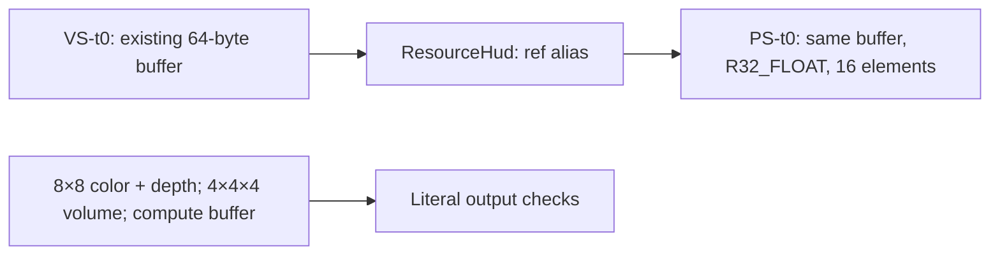

# Develop versus original 3Dmigoto: off-game performance and compatibility

**Measured 13 November 2026.** Target use: Elite Dangerous + EDHM. Ours is
`develop` at `5c74823f`, package **0.1.4-beta.1**. The primary baseline is
**original bo3b/3Dmigoto 1.4.9**, its newest published build at the audit date and
labelled a beta by upstream. **1.3.16** is historical stable context only.
[Original 1.4.9 release](https://github.com/bo3b/3Dmigoto/releases/tag/1.4.9),
[original 1.3.16 release](https://github.com/bo3b/3Dmigoto/releases/tag/1.3.16).

## Brief

Develop's strongest measured advantage is **changing resource references**.
The common production-component operation took **88.5% less CPU time** than
original 1.4.9. With actual DLLs and a HUD-like override, changing-reference
submission took **28.7% less time on Windows WARP** and **30.0% less on AMD with
Proton/DXVK**. Native API traces show why view reuse matters: **65 extra SRV
creations become zero**, while backing-resource, draw, copy and readback counts
remain the same for the corresponding workload.

There are costs: stable references and ordinary resource bindings are slower
in these fixtures. The Windows startup measurements do not establish a win;
Proton startup is lower in this small-configuration test. Memory results are
limited to whole-process private commit on Windows. No result here establishes
an FPS increase, lower VRAM residency, universal GPU compatibility or an
installed-game outcome.

**All 36 accepted timing-probe processes and all five native trace processes
passed literal output and state checks.** Four original and four develop
component processes per workload also passed their result/identity checks.
Six controlled faults confirmed that the offscreen assertions detect changed
color, depth, compute, volume and resource-binding behavior.

Read the tables below for costs as well as gains. The
[raw evidence and reproduction guide](benchmarks/original-comparison-2026-11-13/README.md)
and [technology compatibility appendix](benchmarks/original-comparison-compatibility.md)
keep measurements separate from source/API eligibility.

## What was compared

| Item | Original | Ours |
| --- | --- | --- |
| Product/source | 3Dmigoto 1.4.9, `4ce5f2f7` | EDHM_2DMigoto develop, `5c74823f` |
| Actual x64 DLL | Published `3Dmigoto_v1.4.9.7z` | Fresh Release CI build of develop; DLL version 0.1.4.0 |
| DLL size | 3,338,240 bytes | 3,241,472 bytes; **2.90% smaller on disk** |
| Source-component build | Original production sources, MSVC v143 Release/C++17 | Develop production sources, same toolchain and harness boundary |
| Stereo/NVAPI configuration in the DLL probes | Forced stereo/profile creation disabled | Same shared configuration; stripped stereo/NVAPI control path |

The source-component experiment and shipped-DLL experiment answer different
questions. The former controls toolchain and entry point; the latter measures
actual deliverables, including their build and architecture differences.
Neither isolates the contribution of each commit. Develop includes inherited
XXMI improvements and EDHM changes; the overall A/B difference is not attributed
to this fork alone. Prior isolated local-change evidence remains in the
[implementation report](next-release-implementation.md).

Full SHAs, asset hashes, caller hashes, hosts, configurations and accepted CI
runs are in [provenance.json](benchmarks/original-comparison-2026-11-13/provenance.json).
The source and build workflow are pinned on the separate
[benchmark branch](https://github.com/Fenris159/EDHM_2DMigoto/tree/c66db49af0602286ee448557ca2123e5a35d120c/Benchmarks).

## Measurement method

- Four fresh processes per variant and profile, ordered **A B B A B A A B**.
  A is original, B is develop. DLL probes additionally have raw-system controls
  before and after the passive profile. Controls check the fixture; they are
  not substituted for the original baseline.
- Components: 11 samples per mode, discard sample 0. DLL probes: seven samples,
  discard sample 0 for repeated timings. Each process contributes its median;
  each table reports the median of four process medians. Startup and memory
  each have one observation per process and retain sample 0.
- Intervals are exact enumerations of independent bootstrap median ratios:
  256 resamples per group, 65,536 ratios, interpolated 2.5/97.5 percentiles.
  **Negative change means lower cost.** Intervals crossing zero do not establish
  a directional improvement here. With four processes on one host, these are
  descriptive repeatability intervals, not hardware-population estimates;
  they do not correct for multiple comparisons or remove CI-runner drift.
- Logging, hunting, profiling and the D3D debug layer are off for DLL timings.
  Component profiling modes are explicit. Tracing is a separate, untimed run.
  No window, swap chain, Present loop, game process or FPS measurement exists
  in the probe.
- Times are CPU-side wall durations of the specified operation. Submission
  can include backend work or synchronization; these are not GPU execution
  times. GPU drains surround repeated batches outside the timer. Copy/readback
  deliberately includes its own Map wait and literal-result verification.
- Both variants use the same caller binary **within each backend**, the same
  shader compiler, and identical generated INI. Shader compilation precedes
  the load/device timer. Startup uses a fresh process with warm files/caches,
  and a tiny configuration; it is not cold-disk or large-mod initialization.

## Production-component CPU comparison

Windows Server 2022, software WARP, AMD CPU runner, four logical processors.
A scalar command increments a variable across 64 lists, 500,000 invocations per
sample. References use the same public `ResourceCopyOperation.run` boundary on
both sources: 10,000 operations, one stable buffer or 32 round-robin buffers.
The common source SRVs and 32 × 64-byte buffers are created before timing.
Original production source files are unmodified; generated project adapters
supply a console entry point, output location and common build properties.

| Operation | Original 3Dmigoto 1.4.9 | Ours: develop | Change, 95% interval |
| --- | ---: | ---: | ---: |
| Scalar command, profiling off (ns) | 19.74 | 19.15 | -3.0% [-4.4, -1.9] |
| Scalar command, summary (ns) | 68.69 | 58.38 | -15.0% [-17.3, -14.1] |
| Scalar command, top lists (ns) | 68.56 | 58.68 | -14.4% [-17.0, -14.1] |
| Scalar command, top commands (ns) | 70.38 | 56.31 | -20.0% [-21.3, -18.3] |
| Stable reference, profiling off (ns) | 73.91 | 89.11 | +20.6% [+18.7, +85.5] |
| Changing reference, profiling off (ns) | 1,406.40 | 161.04 | -88.5% [-88.9, -82.1] |
| Stable reference, summary (ns) | 74.26 | 87.81 | +18.2% [-16.7, +20.4] |
| Changing reference, summary (ns) | 1,401.66 | 158.86 | -88.7% [-88.9, -88.5] |

Changing references avoid view creation: **10,000 → 0 factory calls per sample**.
Stable references change **1 → 0**, but take about **15.2 ns more** with profiling
off. The small scalar-command gain is about **0.60 ns** with profiling off;
larger percentages in diagnostic modes should not be presented as normal
runtime savings. These are component costs, not per-frame game costs.

## Actual DLL comparison: native Windows WARP

Windows Server 2022, Intel CPU runner. WARP is Microsoft's software rasterizer;
these timings do not characterize a physical Intel, NVIDIA or AMD GPU.
[Microsoft WARP guide](https://learn.microsoft.com/en-us/windows/win32/direct3darticles/directx-warp).

**Passive** has no matching resource override. **HUD** matches only the probe's
pixel shader and aliases a source buffer from VS slot 0 into PS slot 0 before
the draw. Bind loops use 2,000 calls; HUD loops use 2,000 source-bind + draw
pairs; allocation loops create/release 128 buffers; readback loops use 64 copies
of 256 bytes per sample. All timings include the selected DLL and backend.

| Operation | Original 3Dmigoto 1.4.9 | Ours: develop | Change, 95% interval |
| --- | ---: | ---: | ---: |
| Passive: load + create device (ms) | 81.742 | 87.752 | +7.4% [-47.5, +19.4] |
| HUD: load + create device (ms) | 74.502 | 78.534 | +5.4% [-3.6, +17.5] |
| Passive: stable PS binding (ns) | 40.312 | 61.387 | +52.3% [+49.6, +68.3] |
| Passive: changing PS binding (ns) | 46.087 | 69.300 | +50.4% [+42.5, +59.0] |
| HUD: stable PS binding (ns) | 37.150 | 56.925 | +53.2% [+47.2, +60.4] |
| HUD: changing PS binding (ns) | 46.300 | 68.675 | +48.3% [+38.7, +59.4] |
| HUD: stable reference + draw (µs) | 6.829 | 7.476 | +9.5% [+6.7, +12.0] |
| HUD: changing reference + draw (µs) | 12.789 | 9.122 | -28.7% [-40.4, -25.1] |
| Passive: create/release 64-byte buffer (µs) | 8.197 | 8.217 | +0.2% [-6.7, +7.2] |
| HUD: create/release 64-byte buffer (µs) | 9.013 | 9.321 | +3.4% [-0.4, +6.0] |
| Passive: 256-byte copy + readback (µs) | 104.973 | 105.021 | +0.0% [-2.3, +3.8] |
| HUD: 256-byte copy + readback (µs) | 91.362 | 102.935 | +12.7% [-3.7, +37.9] |

The actual changing-reference workload improves by **3.67 µs per submission**
in this WARP fixture. The stable reference costs **0.65 µs more**. Ordinary
passive bindings add approximately **21–23 ns** each. Allocation and readback
intervals overlap zero, so their point estimates do not establish improvements.
The load/device intervals also overlap zero; Windows startup is not a measured
benefit in this collection.

## Actual DLL comparison: AMD, Linux and Proton

Physical device reported as **AMD Radeon Graphics (RADV STRIX_HALO)**,
PCI **1002:1586**, on an AMD Ryzen AI Max+ 395 host. Linux 7.0.0-42, Mesa
**26.0.8-1ubuntu0.3**, device Vulkan API **1.4.335**, **Proton 11.0-2e**,
bundled **DXVK 2.7.1-498-ga6764047e**. A dedicated test prefix and standalone
`runinprefix` invocation were used; this was not a Steam game launch.
Both variants used the same MinGW-built x64 caller and native D3D11 overrides.

| Operation | Original 3Dmigoto 1.4.9 | Ours: develop | Change, 95% interval |
| --- | ---: | ---: | ---: |
| Passive: load + create device (ms) | 204.635 | 189.391 | -7.4% [-21.3, -2.2] |
| HUD: load + create device (ms) | 210.201 | 196.088 | -6.7% [-10.4, -2.0] |
| Passive: stable PS binding (ns) | 4.700 | 16.062 | +241.8% [+194.7, +266.9] |
| Passive: changing PS binding (ns) | 12.550 | 24.825 | +97.8% [+78.6, +111.8] |
| HUD: stable PS binding (ns) | 4.600 | 16.425 | +257.1% [+246.1, +278.3] |
| HUD: changing PS binding (ns) | 12.175 | 25.425 | +108.8% [+103.3, +120.9] |
| HUD: stable reference + draw (µs) | 0.102 | 0.211 | +107.7% [+96.4, +132.8] |
| HUD: changing reference + draw (µs) | 0.412 | 0.288 | -30.0% [-33.5, -22.9] |
| Passive: create/release 64-byte buffer (µs) | 0.592 | 0.730 | +23.3% [-8.1, +50.7] |
| HUD: create/release 64-byte buffer (µs) | 0.717 | 0.527 | -26.4% [-31.2, +9.7] |
| Passive: 256-byte copy + readback (µs) | 35.795 | 41.357 | +15.5% [-8.5, +27.6] |
| HUD: 256-byte copy + readback (µs) | 45.838 | 40.853 | -10.9% [-24.0, +19.2] |

Changing-reference submission improves by **124 ns**, while the stable
reference costs **109 ns more**. Passive bindings add approximately **11–12 ns**;
large percentage changes arise from a very small original denominator.
Load/device creation is about **15 ms lower** in both profiles on this host.
Do not transfer those percentages to WARP or a different driver. Allocation
and copy/readback intervals overlap zero in both profiles. Wine's PSAPI
`PrivateUsage` returned zero, so **process memory is unavailable**, not zero.

## Surfaces, views and explicit memory traffic

The HUD-like command path is an alias of an existing 64-byte buffer:

A view is an interpretation of backing storage. Reusing an SRV does not
necessarily eliminate storage or a GPU copy.
[Microsoft resource model](https://learn.microsoft.com/en-us/windows/win32/direct3d11/overviews-direct3d-11-resources-intro).
The fixture's inventory is explicit:

| Fixture storage | Count / logical payload | Purpose |
| --- | --- | --- |
| Input buffers | 32 × 64 bytes = 2,048 bytes | One active source or 32-source reference churn |
| Color and depth textures | 8×8 RGBA8 + 8×8 D32 = 512 bytes | Offscreen triangle and depth preservation |
| Untouched volume | 4×4×4 R32_UINT = 256 bytes | Sentinel 3D texture contents |
| Compute output buffer | 256 bytes | 64 known integers |
| Primary resource total | **36 resources, 3,072 logical bytes** | 33 buffers + two 2D textures + one 3D texture |
| Validation staging | Four resources, 1,024 logical bytes | Read color, depth, volume and compute results |
| Initial views | 33 SRVs + one RTV + one DSV + one UAV | 36 interfaces; views are counted separately from storage |

Logical bytes exclude row/heap alignment, metadata, caches and driver allocation
policy. One completion query is separate. Transient allocation loops create
128 additional 64-byte buffers per sample, one caller-owned temporary at a time;
factory-call totals do not mean that all buffers are simultaneously live.

### Lower-layer API trace

Apitrace 14.0 sits **below the compared DLL and above native WARP**. Its five
accepted runs all exit successfully. The raw control loads the tracer directly.
This diagnostic run has one sample and 64 binding/draw iterations; its times and
memory are excluded from all performance tables. The full trace and decoded
calls are archived in [native-trace/](benchmarks/original-comparison-2026-11-13/native-trace/).

| Calls over the complete trace | Passive raw / original / ours, each | HUD original | HUD ours |
| --- | ---: | ---: | ---: |
| CreateBuffer | 162 | 162 | 162 |
| CreateTexture2D / CreateTexture3D | 4 / 2 | 4 / 2 | 4 / 2 |
| CreateShaderResourceView | 33 | **98** | **33** |
| CreateRenderTargetView / DepthStencilView / UnorderedAccessView | 1 / 1 / 1 | 1 / 1 / 1 | 1 / 1 / 1 |
| Draw / Dispatch | 1 / 1 | 129 / 1 | 129 / 1 |
| CopyResource / Map / Unmap | 68 / 68 / 68 | 68 / 68 / 68 | 68 / 68 / 68 |
| CopySubresourceRegion | 0 | 0 | 0 |
| CreateSwapChain / Present | 0 / 0 | 0 / 0 | 0 / 0 |

The 65 extra original SRV creations are above the **shared 33-view fixture**;
develop adds none. The original's creations comprise the initial alias, the
switch to the stable source and 63 changes through the round-robin sources.
The 168 backing-resource factory events comprise setup, validation and transient
allocations, with identical totals across corresponding cases. They do not
represent 168 live surfaces or a measured GPU allocation footprint.

**No additional explicit copies or CPU readbacks** are observed below either
wrapper: four CopyResource/Map pairs are the probe's output verification,
64 are its requested readback batch. Each requests 256 logical bytes, totalling
17,408 bytes per direction, not a measurement of physical memory-bus traffic.
Both HUD traces bind only VS slot 0 and PS slots 0/1. PS slot 1 is set once by
the caller, and remains unchanged in the state check; the HUD override adds
129 PS-slot-0 bindings for 129 draws in each DLL.

This reduced creation work is accompanied by **more metadata/ownership calls**:
HUD GetDesc **457 → 849**, GetResource **262 → 649**, GetType **324 → 591**;
passive GetDesc **4 → 73**, GetType **1 → 139**. Full method counts are in
[summary.json](benchmarks/original-comparison-2026-11-13/summary.json).
These observations are a useful focus for stable-path optimization; they do not
isolate a specific call as the cause of a timing difference. Event-query polling
counts vary with scheduling and are not treated as performance scores.

### Memory observations

| Whole-process private commit, Windows WARP | Original | Ours | Change, 95% interval |
| --- | ---: | ---: | ---: |
| Passive, after device creation | 3,745,792 B | 3,432,448 B | −8.4% [−9.4, −7.6] |
| HUD, after device creation | 3,747,840 B | 3,393,536 B | −9.5% [−9.7, −9.2] |
| Passive, after workload | 7,837,696 B | 7,485,440 B | −4.5% [−8.0, −0.8] |
| HUD, after workload | 12,638,208 B | 12,197,888 B | −3.5% [−19.4, +16.6] |

These are PSAPI process-wide `PrivateUsage` observations, including the caller,
DLLs and software backend. They are neither wrapper-owned allocations nor
VRAM/residency. The final HUD interval crosses zero. The 2.90% DLL file-size
reduction is a separate disk-footprint observation. No GPU residency result
was collected, and no textures-duplicated or stereo-memory multiplier is inferred.

## What “staying out of the way” demonstrates here

Both DLLs pass the same independent requirements in passive and HUD profiles:

| Observable requirement | Required result |
| --- | --- |
| Offscreen 3D triangle color | Every 8×8 pixel is opaque green, `0xff00ff00` |
| Depth output | Every depth sample is exactly `0.5` |
| Untargeted compute output | The 64 literal integers `7` through `70` |
| Untouched 3D volume | Every texel remains `0x11223344` |
| HUD target binding | Same selected backing buffer; R32_FLOAT, first element 0, 16 elements |
| Other state | PS slot 1 retains its original view; vertex shader retains its identity |
| Passive state | PS slot 0 retains its original view |

The color shader emits a constant color; API state checks independently verify
the HUD-like alias. This is not a texture-sampling EDHM shader pack or a
measurement of every game surface. State assertions run after the initial
verification draw; repeated loops and final output checks add workload coverage,
not an assertion of every intermediate game's state.

Six separately compiled probe copies intentionally changed color, depth,
compute, volume, untargeted PS slot 1 or the HUD target binding. Each exited 1
at its intended assertion. The
[receipts and exact fault patches](benchmarks/original-comparison-2026-11-13/checker-sensitivity/)
show checker sensitivity. These are controlled caller faults, not mutations of
the production DLL and not proof of every wrapper failure path.

The demonstrated benefit is fewer view-creation operations
with preserved tested outputs. Develop still wraps D3D11 calls and can change
3D rendering according to configuration. HUD focus and removal of legacy stereo
control do not make it incapable of affecting a game's 3D scene.

## Compatibility across vendors and technologies

| Platform / feature | Original 1.4.9 | Ours | Evidence level |
| --- | --- | --- | --- |
| Native Windows, WARP software D3D11 | Pass | Pass | Actual DLL color/depth/compute/state checks and clean API traces |
| Linux, AMD RADV, Proton 11.0-2e + bundled DXVK 2.7.1 | Pass | Pass | Actual hardware offscreen checks and timing; standalone prefix |
| NVIDIA, AMD or Intel physical GPU on native Windows | Not executed | Not executed | D3D11 API eligibility/source analysis only |
| NVIDIA proprietary/NVK or Intel ANV on Linux | Not executed | Not executed | Driver/DXVK eligibility only; no extrapolation from AMD |
| NVIDIA 3D Vision / NVAPI stereo | Legacy paths present; not exercised | Stereo path removed | Intentional feature difference; ordinary 3D rendering remains |
| DLSS Super Resolution, FSR, XeSS, Reflex | Integration not exercised | Integration not exercised | Version/API prerequisites in the appendix, no certification |
| Frame generation, VR, wined3d, full Steam game launch | Not executed | Not executed | Outside this offscreen comparison |
| Native Linux/macOS or D3D12/Vulkan/OpenGL wrapper | Not established | Not established | Product remains a Windows D3D11 DLL; Proton translates its calls |

The [primary-source appendix](benchmarks/original-comparison-compatibility.md)
explains NVIDIA/AMD/Intel paths, version-scoped DLSS/FSR/XeSS/Reflex prerequisites
and Proton chaining. Original contains NVAPI initialization and profile/stereo
code; its D3D11 core must not therefore be labelled NVIDIA-only. Develop removes
that linked control path and has explicit Wine-aware chaining/defaults. Both
DLLs nevertheless passed the named AMD case. The shared experimental INI disables
library redirection explicitly, so the test does not assign a timing benefit to
develop's automatic Wine defaults.

The measured Proton bundle contains **DXVK 2.7.1**, not DXVK 3.x. Newer DXVK
requirements in the appendix are eligibility guidance for those versions and
are not retroactive requirements of this run.

Original **1.3.16** is retained as context: 3,275,776-byte DLL, pinned archive
and binary hashes in provenance. Its Proton preflight exited 5 before emitting
measurements. The [failed preflight receipt](benchmarks/original-comparison-2026-11-13/stable-context/)
is excluded from timing/compatibility passes. Its cause is not established;
this does not prove universal 1.3.16 incompatibility.

## Priorities supported by these results

1. **Retain compatible view reuse and the tested resource/range semantics.**
   This has the strongest cross-backend timing and call-count evidence, especially
   when a HUD command changes source resources frequently.
2. **Optimize stable binding and metadata paths next.** The extra 11–23 ns per
   passive bind and stable-reference costs are measurable. Use the public state
   and output cases to preserve behavior while investigating repeated metadata
   queries and ownership handling. This report does not justify removing safety
   checks without a separate controlled comparison.
3. **Treat startup and memory claims by backend.** Keep the Proton compatibility
   work; avoid a general startup, allocation/readback or VRAM claim from this
   evidence. Use a larger synthetic configuration only if initialization becomes
   the next specific optimization target.
4. **Expand offscreen vendor coverage when hardware is available.** Native
   NVIDIA/AMD/Intel and Linux NVIDIA/Intel can run these same fixtures without
   game monitoring. SDK technologies need their own integration-specific cases.

The report, raw observations and README example belong to `develop`. Benchmark
harnesses and dedicated workflows remain on `original-3dmigoto-performance`.
This comparison changes no runtime source, game installation or release branch.
