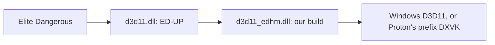

# ED Unofficial Patch with EDHM_2DMigoto

**Source assessment, 13 November 2026.** Compared our develop
`4c953f29127b1d13301c733f157f0850cc2eb309` (0.1.4-beta.1, runtime unchanged
from `5c74823f`) with ED Unofficial Patch (ED-UP) **v0.22.0**, release source
`ba02b6be7003d3c92aa4ee7f1bfc134aeeab084d`, and main
`aa765cd9b90d9b3027c6505157c607d151eeaef5`. The latest published release was
dated 10 November and targets Odyssey build **334925**. Main is 18 commits
ahead. See the [upstream evidence note](benchmarks/ed-unofficial-patch-upstream-research.md)
for release, issue and implementation references.

## Assessment

**The two projects are designed to be composable. I found no fundamental
source-level reason our DLL must disable ED-UP's temporal AA or upscaling.**
ED-UP explicitly supports EDHM chaining, has wrapper-aware context interception,
and contains EDHM shader variants. Our DLL retains the D3D11 device/context,
shader, resource and swapchain interfaces that this composition uses.
This is a source-supported expectation, not a combined execution pass: no
ED-UP binary, game session, AA output comparison or combined benchmark was run
for this investigation.
[ED-UP chaining](https://github.com/characterecho-sean/ed-unofficial-patch/blob/aa765cd9b90d9b3027c6505157c607d151eeaef5/docs/manual-install.md#running-alongside-edhm-by-hand),
[wrapper-aware hooks](https://github.com/characterecho-sean/ed-unofficial-patch/blob/aa765cd9b90d9b3027c6505157c607d151eeaef5/src/common/vtable_hook.h),
[our device/context wrapping](https://github.com/Fenris159/EDHM_2DMigoto/blob/4c953f29127b1d13301c733f157f0850cc2eb309/DirectX11/D3D11Wrapper.cpp#L650).

The principal concerns are the shared DLL filename, load redirection, HUD shader
classification and state restoration. Performance gains are plausible when
upscaling reduces a GPU-bound scene's rendering cost; native-resolution AA and
additional UI processing add work. Nothing in the earlier standalone original
3Dmigoto comparison quantifies this combined stack.

## How the responsibilities meet

Our DLL applies EDHM configuration, theme parameters and shader/resource
overrides. ED-UP reconstructs scene motion and depth, introduces projection
jitter and temporal history, and supplies AA/upscaling plus other game fixes.
Both intercept D3D11; ED-UP is substantially more than a final-image sharpening
filter. Their effects overlap at shaders, constant buffers, HUD composition and
swapchain processing.
[Our command model](ini-command-reference.md),
[ED-UP temporal settings](https://github.com/characterecho-sean/ed-unofficial-patch/blob/aa765cd9b90d9b3027c6505157c607d151eeaef5/edvr.ini#L785).

The supported DLL/export arrangement is:



This depicts DLL ownership and export forwarding. Device/context vtable hooks
also participate, so it does not mean every internal GPU pass follows a simple
three-stage postprocessing sequence.

ED-UP loads the chain after its loader phase and falls back to system exports
when the chained DLL lacks them. Our same-directory target guard accepts a
renamed DLL beside the executable: it compares directories, not a requirement
that our file retain the name `d3d11.dll`. The current ED-UP installer recognizes
`3dmigoto`/`edhm` in version strings; our file description contains `3Dmigoto`.
Recognition of this fork is therefore supported by those source rules, although
the installer was not exercised here.
[ED-UP chain loader](https://github.com/characterecho-sean/ed-unofficial-patch/blob/aa765cd9b90d9b3027c6505157c607d151eeaef5/src/d3d11/d3d11_proxy.cpp#L316),
[our target guard](https://github.com/Fenris159/EDHM_2DMigoto/blob/4c953f29127b1d13301c733f157f0850cc2eb309/DirectX11/DLLMainHook.cpp#L171),
[installer recognition](https://github.com/characterecho-sean/ed-unofficial-patch/blob/aa765cd9b90d9b3027c6505157c607d151eeaef5/src/installer/probe.cpp#L405),
[our version resource](https://github.com/Fenris159/EDHM_2DMigoto/blob/4c953f29127b1d13301c733f157f0850cc2eb309/DirectX11/DirectX11.rc#L83).

The rename also activates the inherited `HookD3D11` branch in `DllMain`, which
detours create-device exports in the module named `d3d11.dll`, normally ED-UP.
Original 1.4.9 has the same branch. Setting `load_library_redirect=0` does not
disable those entry detours, the loader hook or DXGI factory hooks. This is an
initialization/routing boundary to validate, not a demonstrated failure. The
[maintainer report](edup-maintainer-report.md#2-surface-area-what-changes-and-what-remains-shared)
records the source paths and ED-UP's relevant recursion/attachment guards.

## Configuration I recommend for this pairing

These are proposed settings, not changes made to an installation.

1. Let **ED-UP own `d3d11.dll`**. Keep our build beside the executable under
   `d3d11_edhm.dll`, retaining `d3dx.ini`, EDHM-ini and ShaderFixes in their
   existing locations.
2. Set the shared **`edvr.ini`** chain:

   ```ini
   [advanced]
   real_dll = d3d11_edhm.dll
   ```

   An existing `edvr-flat.ini` value can override this, including `none`.
   Use this current setting rather than the older `[chain] d3d11=...` example
   still present in one troubleshooting section.
3. In our **`d3dx.ini`**, use:

   ```ini
   [System]
   load_library_redirect = 0
   allow_platform_update = 1

   [Device]
   upscaling = 0
   ```

   Leave `proxy_d3d11` unset for this arrangement. Do not point our DLL back at
   ED-UP while ED-UP already points at ours.

The rename/`real_dll` arrangement comes from upstream. Disabling our load
redirection is an additional recommendation from our hook's behavior:
`load_library_redirect=2` redirects system D3D11 loads toward the game-local
`d3d11.dll`, which would now be ED-UP. ED-UP has recursion and wrong-module
guards, but avoiding that redirection removes a known chain hazard. Our Wine
profile already selects zero automatically. Keep modern interfaces enabled:
ED-UP's flat resolver queries Device1/Context1 and uses context-state isolation,
which our compatibility setting can otherwise refuse. `allow_platform_update=1`
is already in our shipped template.
[Our load redirection](https://github.com/Fenris159/EDHM_2DMigoto/blob/4c953f29127b1d13301c733f157f0850cc2eb309/DirectX11/D3D11Wrapper.cpp#L1090),
[our defaults](https://github.com/Fenris159/EDHM_2DMigoto/blob/4c953f29127b1d13301c733f157f0850cc2eb309/Dependencies/d3dx.ini#L510),
[ED-UP resolver requirements](https://github.com/characterecho-sean/ed-unofficial-patch/blob/aa765cd9b90d9b3027c6505157c607d151eeaef5/src/d3d11/flat_mono_resolve.cpp#L585).

Our inherited `upscaling` option changes swapchain/backbuffer behavior and is
independent of ED-UP's temporal engines. Keeping it at its default zero avoids
two components attempting resolution/backbuffer management simultaneously.
This is a precaution based on overlapping responsibilities, not an observed
failure of that double-upscale configuration.
[Our legacy upscaling path](https://github.com/Fenris159/EDHM_2DMigoto/blob/4c953f29127b1d13301c733f157f0850cc2eb309/DirectX11/HackerDXGI.cpp#L1079).

## Compatibility risks and existing protections

| Interaction | Finding and significance |
| --- | --- |
| DLL filename and updates | Both normally install as `d3d11.dll`. Overwriting either without chaining removes it from the path. EDHM uninstall/update operations can remove or replace ED-UP's outer file. Upstream documents installer repair. |
| HUD jitter, depth and history | EDHM replacement shaders can differ from the signatures ED-UP classifies. Unsupported variants can lose jitter cancellation, UI-depth coverage or a crisp UI enhancement: haze, ghosting or a feature standing down are plausible outcomes. Current source contains measured EDHM variants; failure is not inevitable. |
| ReShade in a three-mod stack | Upstream documents both loader-guard failures affecting IniParams and an optional SwapChain3 query bypassing EDHM Present. Mitigations predate v0.22.0, but they are evidence to use a recent release rather than assurance about every ReShade/fork combination. |
| Modern COM interfaces | Our swapchain returns unwrapped SwapChain2/3 interfaces. ED-UP's current optional SwapChain3-probe guard avoids the documented wrapper-bypass route. Its context-hook selection also avoids replacing a foreign wrapper object's vptr in the mode known to break wrappers. |
| Live theme/shader changes | Our runtime can replace shaders and run commands around draws/Present. A changed shader variant may alter ED-UP's classifier/history behavior. This remains a combined configuration check, not a demonstrated new reload defect. |
| Game updates | ED-UP's AA/motion hooks and EDHM's shader matches depend on game behavior. A feature declining after an update can be a game-build mismatch even with a correct chain. |

Our `BeforeDraw`/`AfterDraw` and Present processing still matter for theme
variables, commands and reloads. They must not be bypassed in pursuit of a
faster chain. The modern-interface issue is concrete in our source; ED-UP's
existing guard specifically addresses it. I compared v0.22.0 with inspected
main and found no changes in the chain loader, real-DLL decision, swapchain
probe, XeSS engine, UI layer or projection-recipe files cited for these
compatibility boundaries.
[Our swapchain QueryInterface](https://github.com/Fenris159/EDHM_2DMigoto/blob/4c953f29127b1d13301c733f157f0850cc2eb309/DirectX11/HackerDXGI.cpp#L371),
[our draw forwarding](https://github.com/Fenris159/EDHM_2DMigoto/blob/4c953f29127b1d13301c733f157f0850cc2eb309/DirectX11/HackerContext.cpp#L3600),
[ED-UP guard](https://github.com/characterecho-sean/ed-unofficial-patch/blob/aa765cd9b90d9b3027c6505157c607d151eeaef5/src/d3d11/swapchain_probe.h),
[merged repair #111](https://github.com/characterecho-sean/ed-unofficial-patch/pull/111).

Issue #90's HUD-depth problem was marked fixed in 0.20.0 RC2. Issue #118 still
contains theme/black-rectangle reports with incomplete attribution. The older
black-cockpit investigation also explicitly ruled out EDHM as the cause of
that particular fault. These histories justify focused compatibility checks,
not diagnosing every AA or theme problem as a defect in our DLL.
[Issue #90](https://github.com/characterecho-sean/ed-unofficial-patch/issues/90),
[issue #118](https://github.com/characterecho-sean/ed-unofficial-patch/issues/118),
[black-cockpit investigation](https://github.com/characterecho-sean/ed-unofficial-patch/blob/aa765cd9b90d9b3027c6505157c607d151eeaef5/docs/edhm-black-cockpit-2026-09-15.md).

## NVIDIA, AMD, Intel and Proton

| ED-UP mode | Actual implementation | Effect on our compatibility assessment |
| --- | --- | --- |
| TAA | ED-UP's own temporal reconstruction | D3D11 composition; no NVIDIA-specific requirement implied by this mode. |
| DLSS / DLAA | NVIDIA NGX and `nvngx_dlss.dll`, requiring an eligible RTX device | Our removed 3D Vision/NVAPI profile path is unrelated to providing DLSS. NGX/runtime and shader-input compatibility still matter. |
| FSR 3.1 | Community FidelityFX-SDK-DX11 upscaler compiled into ED-UP | An official SDK lacking D3D11 does not block this port. Project documents cross-vendor use; our exact combined hardware matrix is untested. |
| XeSS-SR | Intel D3D12 SDK behind shared D3D11/D3D12 resources | Needs Device5, Context4, shared textures/fences, D3D12 and the runtime. It adds copy/synchronization work; it cannot be certified by a basic D3D11 pass. |

These are temporal upscaling/AA engines. **ED-UP does not itself provide frame
generation.** On Proton, the outer/inner DLLs must still reach the prefix's
translation backend. Our AMD/Proton test in the previous report validated our
DLL alone. It did not validate ED-UP, NGX, or the XeSS sharing bridge. The latter
especially adds D3D11/D3D12 interoperability requirements to the translation
stack. Upstream ships Linux install support and has addressed a DXVK-sensitive
mapped-buffer CPU cost with an adaptive cache; that is encouraging evidence,
not a combined pass on this host.
[ED-UP engines/settings](https://github.com/characterecho-sean/ed-unofficial-patch/blob/aa765cd9b90d9b3027c6505157c607d151eeaef5/edvr.ini#L785),
[XeSS requirements](https://github.com/characterecho-sean/ed-unofficial-patch/blob/aa765cd9b90d9b3027c6505157c607d151eeaef5/src/d3d11/xess_engine.cpp#L794),
[Proton mapping investigation #65](https://github.com/characterecho-sean/ed-unofficial-patch/issues/65),
[our measured platform scope](develop-vs-original-3dmigoto.md#compatibility-across-vendors-and-technologies).

VR here means game/OpenXR integration, not NVIDIA 3D Vision. Removing the
latter from our fork does not by itself remove the former. ED-UP's headset,
runtime and exact-build restrictions are separate requirements, detailed in
the [upstream note](benchmarks/ed-unofficial-patch-upstream-research.md).

## What performance gains are plausible?

| Situation | Expected direction, not a measured combined result |
| --- | --- |
| GPU-bound scene, render resolution below output, temporal upscaling enabled | Potential reduction in scene shading cost; reconstruction, motion/UI passes and transfers consume part of that saving. |
| Native render resolution with DLSS selected | DLAA/image-quality case. Temporal processing adds cost without reducing scene pixels. |
| CPU-bound draw/command submission | Reducing pixel count does not directly reduce wrapper checks or draw submission. Added hooks, classification and mapping work can offset savings elsewhere. |
| Higher UI-quality targets or additional HUD AA | More UI rendering, memory and processing; useful quality features, with their own cost. |
| XeSS bridge | Copies, queue/fence synchronization and extra resource/device requirements affect the result alongside reconstruction quality. |

As a geometry illustration, rendering at 75% of output width and height shades
56.25% as many scene pixels. That is **not** a 43.75% whole-frame time saving:
geometry, CPU work, reconstruction, UI and synchronization do not scale with
that pixel count. The current settings guide distinguishes flat Supersampling
from VR HMD Image Quality; do not assume every resolution control has the
same meaning.
[ED-UP upscaling guide](https://github.com/characterecho-sean/ed-unofficial-patch/blob/aa765cd9b90d9b3027c6505157c607d151eeaef5/docs/fixes.md#upscaling-dlss-fsr-and-xess).

Our earlier **88.5% component reference-cost reduction** and **28.7%/30.0%
HUD-like submission reductions** were narrow standalone workloads. That report
also found slower stable bindings. They cannot be added to ED-UP's gains,
applied to an entire frame or used to predict the combined result.
[Original-versus-develop measurements](develop-vs-original-3dmigoto.md).

## Recommended next step

Use a recent published ED-UP release with the supported outer/inner arrangement,
zero load redirection, modern interfaces enabled and our legacy upscaler off.
Select its temporal engine for the actual GPU/runtime; on the available AMD
Proton host, FSR is the simpler first upscaler to investigate compared with the
XeSS cross-API bridge. This ordering is an inference from implementation
complexity, not a claim that FSR is universally faster or better.

No production-code fix in our DLL is established as necessary by this review.
Before adding one, proposed off-game checks are: correct chain/export and
interface ownership; preservation of IniParams and state around temporal passes;
classifier handling of actual EDHM shader variants; and successful resource/
fence exchange for any selected bridge. A standalone fixture cannot certify
Elite's entire temporal integration. These checks have not been newly written
or run here. No FPS comparison, live-game monitoring or game installation was
performed for this assessment.
