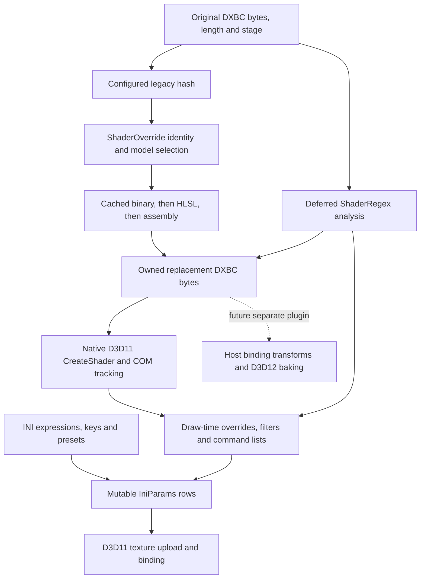

# EDHM_2DMigoto readiness for edo-next

## Status

- **Date:** 16 November 2026; revised against the live artifact at 16:45 UTC.
  Microsoft translation findings and the architecture skill review are integrated.
  The source investigation is followed by a preliminary implementation session.
- **Baseline:** `develop` and remote `main` at
  `4ae925945879a897309992f58db6cc752f22289d`, inspected in the initially clean
  `/srv/sambashare/active/games/EDHM_2DMigoto-develop` worktree.
- **Release relationship:** its runtime matches `v0.1.8`; its tree also matches
  the rechecked, clean vendor snapshot `405b76cc2e2962f1179a4d278b58351aca65182c`.
- **Original checkout:** older branch `chore/vendor-edhm-runtime-v0.1.3` at
  `34d92f27`, with existing changes; left untouched. No branch switches or resets.
- **Host evidence:** updated ABI 1.0.0 artifact dated 16 November, read through
  the browser. It adds shader pairing and PA4b texture tags; it still describes
  an unbuilt design and unpublished SDK. Draft guarantees remain proposals.
- **Conclusion:** the first local repair candidate is safe transition-upload
  failure/retry handling; readiness preparation starts with shader identity and
  asset evidence. Targeted publication/query/execution modules are candidates
  for local optimization. A separate native plugin is plausible for a colour
  core, then texture-filtered panels when PA4b exists. Full parity needs further
  services; a broad renderer rewrite is not justified. Shader and texture hash
  equivalence remain separate blockers.
- **Pre-production:** work now proceeds on `pre-production-edo-readiness`; see
  [checkpoints and validation limits](pre-production-edo-readiness.md). The source
  descriptions below remain pinned to the investigation baseline.
- **Investigation limits:** installed files were read without launching the game.
  Runtime edits and new checks now exist only in the preliminary branch; no game
  installation, merge, release or message to another developer was made.
  No D3D12 rendering, performance gain, MSAA, VR or full product/game Proton
  compatibility is proved.

## Decision and evidence

The smallest local code follow-up is the transition-upload safety repair in
rank 1, including retry of the final value. It is a source-found failure-path
hazard, not a reproduced crash or a measured optimization. The first readiness
artifact is a **read-only shader/configuration/upload inventory** in rank 2,
with exact legacy hash contracts and explicit unknown provenance. It would help
maintain the D3D11 pack and supply inputs for a future port. Follow it with a
bounded offline DXBC tool only when the inventory establishes suitable inputs.
After ranks 1–2, the local structural track prioritizes parameter publication,
bounded read-only query reuse and an inexpensive empty-list path. Normalized
view planning and sparse pool metadata are conditional on advanced workloads.
Parameter publication is the strongest deepening candidate. The empty-list
experiment is a small optimization that can be evaluated first while publication
ownership is scoped. The architecture review below separates depth, measured
cost and workload relevance; speed benefits remain unmeasured.

Keep the D3D11 runtime and its raw-DLL feed. The draft's native renderer needs a
separate `edo_plugin_entry` plugin; today's DLL exports D3D11 creation functions
([exports][exports]). Draft §§1, 4 and 9 provide no interpreter, assembly loader
or per-draw plugin callback. They also refuse the native renderer when a
game-folder `d3d11.dll` proxy is active. A launcher therefore needs explicit
stock/EDUP-chain versus edo-next profile selection; the existing chain is the
fallback, not a component to load concurrently in the proposed renderer.

Evidence sources:

- **Runtime:** `util.h`; `HackerDevice.cpp`; `Assembler.cpp`;
  `SignatureParser.cpp`; `ShaderRegex.cpp`; `HackerContext.cpp`; `Override.cpp`;
  `CommandList.cpp`; `globals.h`; `PersistentSettingsState.h`;
  `ConfigurationLifetime.h`; `IniHandler.cpp`; `HackerDXGI.cpp` and
  `ResourceHash.cpp` / `ResourceHash.h`.
- **Distribution/coverage:** `scripts/write-edup-manifest.ps1`,
  `scripts/update-vendor-cache.ps1`, `.github/workflows/release.yml`,
  `vendor/edup-runtime/manifest.json`, `RuntimeTests/README.md` and existing
  settings/frame-action cases. Source links below pin the baseline commit.
- **Microsoft implementation references:** the [translation-layer study][ms-study]
  pins D3D11On12 `c6b5a961ee5e0761136fc2091b5e57f7bd9235f2` and
  D3D12TranslationLayer `4b9c8f8a49c9b68df19be817d56f123d65704fd2`, plus
  official API and separate DXVK/vkd3d-proton evidence. These inform requirements,
  not claims that our installed backend contains that implementation.
- **Local structural references:** the [structural review][structural-study]
  identifies duplicated parameter-publication policy, repeated texture queries,
  late empty-list detection, region-view eviction and whole-pool metadata
  cloning. Benefits are unmeasured; advanced-pool/region relevance is conditional.
- **Current proposal:** [live edo-next artifact][draft], observed frame revision
  `manifest.5b7cfc6bd2140d9e.json`. The ABI number and displayed date have not
  changed with this content revision. Section references below mean this version,
  including §5.3 texture tags and §5.4 config/hotkeys. This is a design source,
  not SDK/runtime evidence.
- **Earlier proposal:** [saved extracted text][saved-draft], SHA-256
  `f894cc5ba4f6ef941df750af2ea339c1dd7cae42ec7ac52aecc14cdee359ec0c`.
  Retained unchanged as historical evidence; it lacks the new services.
- **Earlier comparison:** [ED-UP launcher investigation][comparison], including
  its Status and dated edo-next section. Its earlier texture-filter deferral is
  superseded here. The current launcher, EDVR add-on ABI and proposed edo-next
  ABI remain separate contracts.
- **Assets:** the installed Odyssey product's `d3dx.ini`, its nine-file include
  graph and linked EDHM_UI shader/theme files, read only. This is one local pack,
  not the draft's historical counts or an audit of all EDHM configurations.

## What the updated proposal changes

| Area | Revised preparation decision |
| --- | --- |
| Shader pairs, §5.1 / PA4 | Inventory PS rules that require/exclude particular original vertex shaders. This is a pipeline filter, not general cross-stage command execution; VS overrides cannot use pairing. |
| Texture tags, §5.3 / PA4b | Promote texture-key, descriptor and numeric-filter inventory to immediate preparation. Plan a texture-filtered panel proof after the basic plugin proof, when PA4b is implemented. |
| Hash compatibility | Keep the shader FNV mismatch open and add an independent texture CRC/descriptor contract. Neither equality is proved by the draft. |
| Cost | Tags add host work at texture creation and binding construction. The draft requires a performance gate before PA4b ships; it supplies no measurements yet. Those host costs and shader branches still require measurement. |
| Remaining gaps, §§10–11 | Keep render-target/index-buffer filters, scene detectors, texture substitution, full skip pipelines and overlays in a later stage. Tags alone cannot replay INI command lists. |

The [Microsoft study][ms-study] is integrated below: rank 1 covers the local
upload failure, rank 2 inventories semantic costs, ranks 6–7 define host cache,
lifetime and submission acceptance, and rank 9 separates platform validation.
Keep the native D3D11 route and EDUP's unwrapped D3D12 helper interfaces. Do not
import the full translation libraries, ship a private OS mapping DLL, or force
the game through On12 as an unmeasured optimization.

## Dependency map and shader identity

The hash is computed from **original** creation bytes before replacement;
successful shader handles retain that original identity. Stage is a separate
creation argument and filename suffix, not an extra byte in the hash. Overrides
use a 64-bit `hash=` key; shader files use 16 lowercase, zero-padded hex digits
plus `-ps`, `-vs`, etc. ([creation][creation], [override lookup][lookup],
[filenames][filenames]).

| Configured mode | Exact source contract | Exporter/host obligation |
| --- | --- | --- |
| `3dmigoto` / default FNV | Seed zero; `h = (h * 0x100000001b3) XOR octet`, modulo 2^64, over the complete supplied original buffer and length. | Preserve filenames and the exact original container, including non-code data; never hash the replacement instead. |
| `embedded` | Read the first 64 bits of the DXBC embedded digest and byte-swap for the displayed digest order; short buffers fall back to FNV. | Reproduce truncation and byte order, not a newly calculated standard MD5. |
| `bytecode` | CRC32C, seed zero, over selected code/signature chunk payloads in chunk-table order: SHDR/SHEX, ISGN/ISG1, PCSG/PSG1, OSGN/OSG5/OSG1. Invalid containers or a zero result fall back to full-buffer FNV. | Record the mode and chunk order; exclude chunk headers and other sections exactly as the implementation does. |

Sources: [mode names][modes], [configuration selection][hash-config],
[FNV implementation][fnv], [chunk selection and fallback][hashing]. The local
root INI selects `shader_hash=3dmigoto` at line 1301. This zero-seeded,
multiply-before-XOR algorithm corresponds to FNV-0, not the draft §5.1's
FNV-1a wording ([RFC 9923][fnv-rfc]). Host equality is unresolved; changing the
runtime hash would break the compatibility being preserved.

Proposed independent known answers, **not tests implemented here**: empty
input → `0000000000000000`; byte `01` → `0000000000000001`; bytes `01 00` →
`00000100000001b3`. Add real original-DXBC fixtures with frozen stage, length,
SHA-256, game build and expected legacy key. Replacement filenames alone cannot
establish those answers. No shader-named original `.bin` was found in the
inspected product tree, and its ShaderCache was empty. Game version text says
`2026.10.23.334925`; this does not prove the provenance of every replacement.

### Texture identity and tag semantics need their own contract

PA4b proposes game-build-scoped texture content/descriptor keys and numeric tags
read by shaders for each bound slot. This is separate from 64-bit shader
identity. Current Texture2D creation chains a data CRC into a copied
`D3D11_TEXTURE2D_DESC`; dimensions may be normalized relative to the selected
screen resolution ([creation hash][texture-create], [descriptor hash][texture-desc]).
The `texture_hash` setting selects legacy versus accurate data handling, with
first-subresource, row-pitch and padding rules; optional update tracking also
changes the lifetime of the identity ([data hashing][texture-data],
[update tracking][texture-updates], [settings][texture-settings]). The local pack
uses default `texture_hash=0` and `track_texture_updates=0`, with resolution
obtained from the swap chain. A generic CRC32C over image bytes is insufficient
evidence that existing keys carry over. Preserve the selected legacy behavior.

The numeric result also has semantics: no bound resource gives negative zero,
a bound resource with no match gives positive zero, a match without an explicit
index gives 1, and overlapping matches select the last indexed match in the
ordered list. Hash/fuzzy precedence and draw-time predicates affect that list
([filter query][texture-filter], [matching order][texture-matching]). `checktextureoverride` additionally
executes matching command lists ([command execution][texture-commands]); a
numeric tag cannot reproduce those side effects. Inventory pure queries and
commands separately rather than treating all 503 TextureOverride sections as
portable texture tags. Render-target and index-buffer entries remain distinct.

## Offline DXBC preparation: concrete reuse, bounded scope

[Replacement selection][selection] first accepts a cached `_replace.bin` or
`.bin`, then tries HLSL `_replace.txt`, assembly `.txt`, and optional automatic
patching. Cache validation uses exact source/binary timestamps; binary-only
files can be accepted with a warning ([cache policy][cache]). A future exporter
should record content hashes and compiler/settings provenance independently,
while leaving the live cache policy unchanged.

The CPU output ends at owned replacement bytes. Native
`mOrigDevice1->Create<stage>Shader`, class linkage, retained originals, handle
maps and reload ownership begin the device/lifetime portion
([boundary][device-boundary]). Reusing the whole `HackerDevice` would bring
globals, Win32 file policy and COM ownership into an offline tool unnecessarily.

- **Assembly:** the ordinary route copies the original DXBC container and
  replaces its code chunk. However, the existing
  `AssembleFluganWithSignatureParsing` can manufacture a container from complete
  assembly signature comments ([runtime call][asm-call], [standalone helper][signatures]).
  The installed pack enables `assemble_signature_comments=1`; all 77 assembly
  files have model and input/output signature headers. Original bytes are
  required for the reuse-container route and for proving original identity,
  but are **not universally required to assemble replacement bytes**.
- **HLSL:** preserve explicit profile, entry `main`, optimization flags,
  compiler identity and include resolution. Existing code uses `D3DCompile`
  before any device creation ([compiler path][hlsl], [Microsoft API][compile-api]).
- **Validation:** the custom assembler handles DXBC SM4/5 syntax, not arbitrary
  DXIL. Unknown instructions can fail; some opcode handling is marked unverified.
  Treat every parse diagnostic as fatal in a new tool. Current runtime policy
  need not change ([assembler][assembler], [diagnostics][asm-errors]).
- **Metadata:** raw assembly retains other original chunks, potentially stale
  RDEF metadata; the manufactured route need not include full reflection data.
  Inspect actual final declarations/instructions and signatures. Microsoft
  [reflection][reflect-api] is useful where metadata exists, but cannot replace
  this check. Container changes and checksum repair are in [assembler output][asm-output].

The smallest artifact is **one replacement DXBC plus a provenance/inventory
record**: original mode/key/stage/build and byte digest or explicit unknown;
replacement-source digest, signatures/registers, include dependencies,
assembly mode or compiler/profile/flags, output digest, and unsupported INI
conditions. A signature-manufactured replacement must not be presented as
proof of its original hash. No new D3D12 loader, PSO builder or general backend
interface is needed. `DirectX11` already compiles the assembler helpers; no
ready offline exporter exists in the slim build ([project inputs][project]).

The host must own `t120` transformation, block rebasing, descriptors, root
signatures and D3D12 variants. Bytecode is only one part of a pipeline;
root signatures must match its bindings ([Microsoft root-signature rules][root-api]).
Compilation or disassembly success therefore cannot establish D3D12 output.

## Current asset capability map

Counts below exclude semicolon comments and the unincluded `Dev-full.ini`.
They describe source declarations, not evaluated branches or a compatibility
percentage. The include graph is root + six explicit INIs + two recursive
add-on INIs. Its links resolve to `/home/drew/EDHM_UI/ODYSS/EDHM/`.

| Feature | Observed evidence | Readiness under the draft |
| --- | --- | --- |
| Static replacements | 77 assembly files: 74 PS, 3 VS; 75 declare `t120`. Other declarations use only b0–b2, t0–t6 and s0–s2. | Reusable inputs for offline assembly; preliminary register fit after the proposed transform, not rendering proof. |
| IniParams | Literal reads reach row 333: at least 334 HUD rows. `29ab32c907cda633-ps.txt:426–432` also selects rows 41/42/43 dynamically. | Requires host transform with bit, indexing, swizzle and bounds equivalence; replacing only literal addresses is insufficient. |
| Assignments/themes | 216 assigned row indices; 834 distinct component keys. ThemeSettings metadata names File/Section/Key/Value. | Bounded static settings import is plausible; expressions and post writes require classification. EDHM_UI rewrite is not established as necessary. |
| Shader pairs | Runtime queries bound shader stages and ShaderOverride indices; a pack-specific count of pairable rules is not established ([query][shader-filter]). | PS require/exclude-VS filters are planned in PA4. Inventory only rules expressible by original VS identity/structure; VS-side gating and general command lists remain unsupported. |
| Shader conditions and scenes | 45 ShaderOverride sections, 32 presets; root lines 599–605 trigger galaxy-map state, and 721–735 use texture filters. | Separate constant branches, PA4b tag-based texture branches and draw-triggered scene flags; the last still needs detectors. |
| Texture filtering | 503 TextureOverride sections span multiple resource kinds; they include texture keys and descriptor predicates. | Texture-only numeric filtering is planned for PA4b, subject to exact hash, matching, tag and update semantics. Tags do not execute `checktextureoverride` command lists or replace textures. |
| Render-target/index-buffer filtering | The same section inventory also includes render-target size predicates and index-buffer hashes; 43 `match_index_count` declarations are draw-dependent. Root lines 135–140 query `o0` and `ib`. | Still later services. A texture's creation-time identity is not the current render target or index-buffer binding state. |
| Skip behavior | Five `handling=skip` assignments; root 709–718 gates skips on values. | Restricted shader gating needs output/side-effect proof; full draw suppression waits for skip pipelines. |
| Keys/transitions | Two FSS key cycles share `0x8f`; no explicit transition setting in these nine files. | Port cycle logic and preserve both actions. Runtime transition support exists, but the sample does not establish a need to extract it now. |
| Texture replacement | Six FSS ResourceReplace entries and conditional `ps-t2` bindings. | Later texture/binding services; list FSS overlay as unsupported in a colour-core port. |
| Custom warning drawing | Separate add-on uses row 340, t100–t102, a CustomShader, `draw=4` and save/post-restore command lists. | Outside v1; a host toast could replace notification intent, not the existing renderer. This accounts for a 341-row runtime extent, distinct from the HUD's 334-row extent. |
| ShaderRegex | None in this local include graph. Runtime supports both assembly rewriting and linked draw commands. | Pure rewriting may be reusable offline; command linkage is a separate unsupported behavior ([regex][regex]). |
| Reload | Root line 1280 watches ThemeSettings.json; current runtime polls mtime and performs full reload. | Draft constants/config may update live; replacement shaders require restart. Preserve and disclose that distinction ([watch/reload][watch], draft §§1, 5.4). |

Sample fingerprints: root `d3dx.ini` SHA-256
`4cd59597cdfedf88654f0cdb91f3901afb1b895daac98bac82cadaf74d96dc51`;
dynamic-index shader SHA-256
`5044f3c49f288bd684f24722c376286ed2b923532103b626223738fcb3042faa`.
Root identifies EDHM 22.04 while theme metadata uses 22.03 labels. Re-inventory
before implementation; these files are not authoritative proof of pack-wide
build support. No EDHM shader/theme contents are redistributed by this report.

Local evidence anchors: [root include list and configuration](</home/drew/.local/share/Steam/steamapps/common/Elite Dangerous/Products/elite-dangerous-odyssey-64/d3dx.ini:53>),
[dynamic shader read](/home/drew/EDHM_UI/ODYSS/EDHM/ShaderFixes/29ab32c907cda633-ps.txt:426),
[FSS cycles and textures](/home/drew/EDHM_UI/ODYSS/EDHM/EDHM-Ini/3rdPartyMods/FSS-Overlay/FSS-Overlay.ini:78),
[custom warning commands](/home/drew/EDHM_UI/ODYSS/EDHM/EDHM-Ini/3rdPartyMods/EDHM-Build-Warning/EDHM-Build-Warning.ini:60)
and [theme field mapping](/home/drew/EDHM_UI/ODYSS/EDHM/EDHM-Ini/ThemeSettings.json).

## Parameter reuse and thread ownership

`PersistentSettingsState` is already a CPU-only helper for unknown-value
retention; moving it into a new abstraction would add no capability
([helper][persistence]). Reuse it only if the plugin adopts that exact policy.
Its surrounding file transaction and parser are separate responsibilities.

There is a small value-at-time calculation in `_UpdateTransition`, but the
surrounding preset engine reads live globals, runs device-dependent conditions
and command lists, changes persistent variables and uploads rows
([activation][activate], [interpolation/update][transitions]). A whole preset or
INI parser extraction would not produce a renderer-independent module.

Assignments write `G->iniParams`, marking a command state dirty; flushing maps
the D3D11 texture and copies the whole vector ([assignment][assignment],
[flush][flush]). Reload replaces configuration objects and may resize/rebind
that texture under configuration and save ownership ([reload][reload],
[lifetime rules][lifetime]). Atomic scalar variables do not make the row vector
or borrowed command pointers safe for an unrelated plugin thread.

For a future bounded plugin, own values on its plugin thread and publish copied,
immutable row snapshots with a generation. Use explicit elapsed host time for
transitions: draft §3 coalesces frame callbacks. Do not count callbacks as game
frames. A shader-worker transform should consume immutable data, never live
`G`, device/context objects or parser pointers. Copy-on-return is a draft §2
promise to validate against the SDK, not permission to share live globals.

## Ranked preparation plan

| Order | Work | Entry condition |
| --- | --- | --- |
| 1 | Guard failed transition uploads and retain pending final values | Small local follow-up; confirm proposed cases before implementation/tests. |
| 2 | Inventory identities, selectors, uploads and readbacks | Useful now; read existing inputs only. |
| 2A | Centralize parameter publication and retry ownership | After the rank 1 repair and upload inventory; migrate callers incrementally. |
| 2B | Reuse pure query results within bounded command segments | After identifying actual repeated queries and all invalidation effects. |
| 2C | Check resolved empty lists before preparing execution state | Small measured experiment under the existing configuration lease. |
| 2D | Normalize resource/view requests; consider sparse metadata | Advanced-workload evidence required; separate view and pool changes. |
| 3 | Agree settings and separate-package contracts | Useful now as design; packaging code needs an actual plugin/checker. |
| 4 | Prepare reproducible offline DXBC | Conditional on inventory inputs and a bounded tool scope. |
| 5 | Reuse a narrow values/transition subset | Conditional on a concrete second consumer. |
| 6 | Prove one native plugin and its ownership/submission contract | Wait for SDK and host. |
| 7 | Prove one texture-filtered panel with correct cache invalidation | Wait for PA4b and exact tag/hash semantics. |
| 8 | Restore remaining scene/resource behavior and optional overlays | Wait for later host services. |
| 9 | Run capability-based backend/device validation | Optional separately authorized off-game lane; no default backend change. |

### 1. Guard transition-upload failure and final-value retry — local follow-up

**Benefit/scope:** prevent a failed Map from reaching an invalid memcpy/Unmap.
`UpdateIniParams` currently ignores Map's HRESULT; the command-list upload path
checks it ([transition upload][transition-upload], [checked upload][flush]).
Guard success-dependent work and retain pending CPU values until an upload
succeeds or a defined device-loss path takes over. Completed transitions are
erased before upload ([transition update][transitions]); simply returning on
failure could permanently omit the final GPU value. Keep the repair separate
from interpolation extraction or upload coalescing.
**Risk/dependencies:** small code scope, medium retry/order risk; no SDK needed.
This hazard is untested and is not attributed to issue #52. Agree observable
failure/retry cases before adding tests under the repository's process.
**Proof:** failed mapping performs no copy/Unmap and does not report a completed
upload. For a transition ending at 4, failure at completion retains 4 for the
next successful upload even after its transition entry was removed. Repeated
failures preserve the newest pending values; normal transitions, reload and
pre/post command ordering retain their existing behavior. A later trace may
justify removing redundant uploads; no speed improvement is assumed here.

### 2. Freeze identity and produce a passive inventory — useful now

**Preliminary implementation:** [the passive inventory tool](readiness-inventory.md)
now covers local INI/include and replacement evidence. It does not complete the
original-identity, build-provenance or semantic-cost evidence gates below.

**Benefit/scope:** detect mismatched shader keys, missing provenance and
unsupported add-ons before a port. Read existing inputs only; record the fields
above and resolve includes without executing commands. Include texture hash
version, descriptor/resolution/data provenance, update policy and filter values;
split texture queries from target/index-buffer rules and command-list effects.
Inventory PS pairing candidates by required/excluded original VS identity;
none were established in this sample, so do not invent a pairing benefit.
Keep existing names and matching. Evidence: [hashing][hashing],
[selection][selection], [texture hashing][texture-data] and the local map.
Also record upload points, dirty-state ownership, retained staging sizes and
rules requiring synchronous readback. `store` uses a bounded copy and immediate
Map, and staging buffers already use size buckets ([store][store-command],
[pool][readback-pool]). Do not turn it into a delayed result or merge all live
INI uploads into one Present; draws in one frame may require different values.
**Risk/dependencies:** low; original capture/build provenance remains an explicit
missing input, not a reason to infer it from modified text.
**Proof:** the selected fixture reports 77 replacements and its excluded file;
identifies the dynamic read and FSS/custom-draw gaps; all input digests remain
unchanged. Future confirmed hash tests use the literal answers above plus
independent original-container fixtures, stage naming and embedded endianness.
Editing only an excluded container section must distinguish full-buffer FNV
from bytecode mode; malformed/zero bytecode-hash cases exercise fallback.
For textures, use separately frozen descriptor/data fixtures for padded rows,
compressed formats, empty initialization, first-subresource selection and
screen-relative dimensions. Preserve the current mode's literal expected key;
an accurate image checksum is not a replacement for a legacy filter key.
Two draws needing different row snapshots must retain both outputs; failed
`store` reads keep the previous value. Reuse existing off-game traces/counters
for CPU cost, allocations, copied/uploaded bytes and waits; no FPS or live-game
monitoring is part of this preparation.

#### Local structural track after ranks 1–2

This architecture review applies the deletion test to the existing implementation:
a deep module earns its interface when removing it would scatter policy across
callers. Moving code or adding a pass-through module does not supply depth.
The scan followed recent changes: among the latest 30 commits touching
`DirectX11`, `HackerDXGI.cpp` appears in 12, `CommandList.cpp` in eight and
`IniHandler.cpp` in six. Those counts guide attention; they prove no speed gain.
No `GLOSSARY.md` or `docs/adr/` existed at the inspected baseline. The preliminary
branch now records [domain terms](../GLOSSARY.md) and the proposed publication
decision; their status is separate from the source investigation.

| Candidate | Strength | Locality and leverage | Gate before implementation |
| --- | --- | --- | --- |
| 2A: IniParams publication | **Strong** | One ownership policy across commands, transitions and initialization | Repair rank 1, inventory upload ordering, then choose the module's interface |
| 2B: Direct texture queries | **Worth exploring** | One place owns read lifetime, effects and invalidation | Measure the repeated EDHM query and prove invalidation is contained |
| 2C: Empty command lists | **Small optimization experiment** | Avoid setup on a proven empty invocation | Preserve leases, dynamic/proxy resolution and profiler outcomes |
| 2D: Region-view requests | **Worth exploring, conditional** | Share range/descriptor decisions across validation and reuse | Obtain an actual Region workload and count avoidable view creation |
| 2E: Pool metadata previews | **Speculative** | Contain selection/expiration/adoption policy | Demonstrate whole-preview cost in a real Pool workload |

**Working order:** finish the rank 1 safety repair and rank 2 inventory first.
The bounded 2C measurement can precede the larger refactors while 2A is scoped;
2A is the first architecture candidate, followed by 2B if its cost is material.
Keep 2D and 2E separate and conditional. Ranks 3–9 retain their existing SDK and
asset gates. No future renderer adapter is justified by a hypothetical consumer.

**Selection and verification:** the candidates describe responsibility, not a
chosen interface. Select one, explore its constraints and alternative seams,
then record the decision before implementation. Keep existing observable tests;
do not delete or weaken them to suit a refactor. New cases require confirmation
before code is written. Measure each accepted change separately with profiling
overhead identified, unchanged outputs and a nonempty/mutation-heavy control.
Reject a proposed module if callers must still coordinate the same policy.

#### 2A. Deepen IniParams publication — Strong

**Preliminary implementation:** context-owned pending publication is now drafted,
with original upload points and CPU values retained. The
[proposed decision](adr/0001-context-owned-iniparams-publication.md) and
[validation status](pre-production-edo-readiness.md) qualify this first stage;
redundant-upload suppression remains unimplemented.

**Problem:** commands, transitions and initialization share knowledge of pending
CPU values, GPU contents, retry and legal upload ordering across
[flushing][flush], [transition uploads][transition-upload],
[initialization][init-params] and [texture recreation during reload][reload].
**Candidate:** concentrate that publication policy in one module after rank 1.
Interpolation, preset selection, parsing and file persistence remain separate
responsibilities. The interface and representation are still open decisions.
**Deletion test/locality:** removing the module should make retry, recreation
and successful-publication knowledge reappear in those callers. A Map helper
that leaves all that knowledge at each caller is shallow. The desired depth
hides this policy; its leverage reaches three existing production paths.
**Dependencies/seam:** in-process values and configuration lifetime; external
D3D operations, classified as **mock** for controlled failure testing. Retain
real product/WARP output checks as well. A failure adapter is justified only
for errors the native fixture cannot control; keep such a seam internal and
require a concrete production and test use before adding indirection.
**Constraints:** preserve legal publication points, initial zero contents before
[Constants], reload and pre/post order. Recreated textures require the right
contents again. Keep the current GPU representation and full discard contents;
do not bundle once-per-frame coalescing or a new backend.
**Proof:** failed-final-value retry survives every caller; two draws requiring
different rows retain both outputs; recreation/reload republishes required
contents. Existing hotkey/transition/reload GPU checks remain applicable
([coverage][runtime-coverage]). Compare Map count, uploaded bytes and CPU cost;
central ownership alone supplies no measured speed result.

#### 2B. Deepen direct-query lifetime and effects — Worth exploring

**Inventory refinement:** the root's nine adjacent texture mentions include
eight `checktextureoverride`-then-query pairs and one assignment-then-query pair
at lines 733–734. The [classified candidates](benchmarks/edo-pre-production-2026-11-16/query-candidates.json)
are not nine safe reuse opportunities: the effectful command can run matched
pre/post lists. Start native cost measurements with the one repeated-read pair
and retain those commands as conservative invalidation boundaries. A simpler
pack-level expression using an already assigned value is also worth evaluating
under the same observable-output gate; the installed configuration was not edited.

**Problem:** the installed root INI reads `ps-t0` at lines 733 and 734;
[filter evaluation][texture-filter] repeats resource/view lookup and match
construction through [target lookup][query-lookup]. Generic getters can also
materialize or expire resources, while `checktextureoverride` executes commands.
**Candidate:** investigate a module that owns reuse of direct-query observations
within a proven read-only command segment and contains its invalidation policy.
**Deletion test/locality:** removing it should force callers to recover effect,
validity and owned-reference knowledge. A result dictionary that asks every
caller to supply invalidation rules simply moves complexity. The leverage is
shared query evaluation; depth depends on hiding that knowledge correctly.
**Dependencies/seam:** **local-substitutable** for binding/matching experiments
using the existing native D3D/WARP fixture, with in-process match metadata. Use
the existing context seam; do not invent a public renderer adapter for one
consumer. Unknown custom/proxy calls conservatively end the reuse period.
**Constraints:** include binding/context, resource/hash, draw-information,
configuration and pool dependencies. Preserve getter effects and command order.
No frame-wide cache or cached `checktextureoverride` execution is proposed.
**Proof:** repeated pure reads retain exact indices with fewer lookups and match
allocations; rebinding, changed hashes, draw inputs and intervening commands
change results immediately. Preserve signed zero, match priority, no-index
semantics and pool behavior. Compare the real EDHM example with a mutation-heavy
control; retain existing command/resource checks at their current interface.

#### 2C. Measure the empty-list path — small optimization experiment

**Preliminary experiment:** the guarded path and a public-entry benchmark are
now drafted on the pre-production branch. Retention still requires the native
comparison and regression gates in the [session status](pre-production-edo-readiness.md).

This change does not establish a deepening opportunity by itself. After the
existing configuration lease, [RunCommandListComplete][execution-entry] might
avoid execution-state and device/context setup for a proven empty resolved list;
today [_RunCommandList][list-dispatch] discovers emptiness afterward.
Preserve per-invocation proxy resolution and conservative handling of
runtime-populated lists. Nested leases already reuse outer ownership, and the
[optimizer][command-optimizer] already folds constants and eliminates no-ops.
**Proof:** empty pre/post lists retain output and profiler results; lists that
gain commands execute them on their next invocation. Measure empty and nonempty
CPU cost separately. Retain this step only if the saved work is material;
no synchronization removal or bytecode-interpreter rewrite follows from it.

#### 2D. Deepen region-view request handling — Worth exploring, conditional

**Problem:** ordinary descriptor-aware reuse already exists, but
[Region references discard cached views][region-views] on every invocation.
Range, kind and format facts span validation, reuse and creation.
**Candidate:** investigate one module that contains those decisions for a single
invocation; selecting a request type or interface comes later.
**Deletion test/locality:** useful depth means callers can forget descriptor
normalization and ownership rules. A shared record that leaves those decisions
at each caller remains shallow. Leverage spans validation, reuse and creation.
**Dependencies/seam:** **local-substitutable** through existing native D3D/WARP
resource checks; keep actual COM ownership and descriptor verification at that
seam. No new adapter protocol is needed for the current renderer.
**Gate/constraints:** the inspected nine-file EDHM graph has no Region
expressions. Obtain a relevant workload before implementation. Preserve exactly
once destination evaluation, owned/borrowed references and effective view kind.
**Proof:** identical requests reuse a view; changing range, format, kind or raw
mode invalidates it. A float view of bytes 8–23 has FirstElement 2 and
NumElements 4. Retain existing view/copy regressions and compare view-creation
counts, allocations and CPU cost. No current-pack benefit is assumed.

#### 2E. Deepen pool metadata policy — Speculative

**Problem:** [metadata previews][pool-preview] clone occupied pool state, maps
and variables; [one preview is already reused per root pool per operation][pool-preview-use].
The cost is not a whole-pool clone on each lookup.
**Candidate:** consider sparse preview state only if a relevant workload shows
material cost, while containing selection, expiration and adoption policy in
one module. A sparse implementation is a hypothesis, not a chosen interface.
**Deletion test/locality:** removing a deep module would scatter those semantics
across query and copy callers. A smaller container that leaves callers managing
commit/rollback remains shallow. Potential leverage spans metadata queries and
copies, with high semantic risk.
**Dependencies/seam:** selection/preview state is **in-process** and requires no
adapter. Keep external GPU creation and COM ownership checked by existing native
fixtures; do not invent a second renderer to justify a seam.
**Gate/constraints:** the inspected graph has no Pool sections. Preserve FIFO,
spatial reuse, expiration, STATIC pins, aliases, provisional resources and
exactly-once destination evaluation. Keep this separate from 2D.
**Proof:** metadata and skipped copies leave live elements, keys and expiration
unchanged; accepted copies adopt the intended provisional resource once. Reuse
existing pool cases and compare small/large pools, allocations and CPU cost.

#### Recent hotspot to revisit: proxy frame arbitration

[ProxyFrame already owns its active scope and reference][proxy-frame], and
[RunFrameActions is already shared][frame-actions]. Extracting them into another
file would add no depth. Later work may earn a module if it concentrates the
coordination of command eligibility, forwarding suppression, owning chain/thread
and native lifetime retirement. First recheck the separate proxy-scope fixes and
integration baseline; recent churn alone justifies neither a rewrite nor a
performance claim. Preserve native-lifetime callbacks' independence from retired
global state and all existing public COM, image-order and thread checks. Keep
current settings-save/reload ownership as well; a generic storage adapter has
no demonstrated second consumer. These observations do not block ranks 1–9.

### 3. Agree the settings and distribution contract — useful now as design

**Benefit/scope:** avoid updater damage to editable themes and retain the current
DLL channel. Existing [manifest generator][manifest] already emits tag-pinned
URL, version, architecture, size and SHA-256; [release packaging][release]
publishes both DLL names. Draft §§7–8 need a **separate plugin ZIP**, inner
`edo-plugin.json` (id, entry, ABI/services/builds/modes/order/file hashes), and
`<id>.edo-update.json` adding id, ABI range, game builds and structural-only
status. Reuse metadata conventions, not the raw DLL's identity.
**Risk/dependencies:** low for a written schema/settings map; generator and CI
implementation wait for the SDK/checker and an actual plugin. Keep packaged
defaults immutable; edited values belong in the draft's per-plugin settings
directory. Investigate whether EDHM_UI can keep its formats and write/sync that
path, including a change-generation signal; do not assume an editor rewrite.
**Proof:** a later package check verifies every listed file and pinned ZIP hash;
an update changes defaults/binaries while a pre-existing user theme survives
byte-for-byte. Stock D3D11 feed/layout remains usable. Signing is optional in
the draft, expected for automatic updates; agree signed-byte format, issue time,
key pinning/rotation and prerelease feed before adding it.

### 4. Build a small offline DXBC preparer — conditional on inventory evidence

**Preliminary evidence:** all 77 copied HUD assembly replacements produced DXBC
with the existing upstream helper and passed its Flugan round trip and Microsoft
disassembly. The
[receipt and limits](benchmarks/edo-pre-production-2026-11-16/README.md#one-copied-assembly-input)
record exact hashes, the architecture-matched compiler and a precision loss in
Microsoft's default text disassembly for one input. This satisfies a pack-wide input/reuse
experiment, not the complete tool or rendering gate. Keep immutable input copies
in separate directories: the stock helper can overwrite its staged assembly
while disassembling. Pin compiler architecture and prevent implicit fallback.

**Benefit/scope:** reproducible replacement bytes useful to existing binary
distribution as well as a future host. Start with one signature-complete HUD
assembly file and the existing [standalone helper][signatures]; add original
container and HLSL routes only when needed. Emit DXBC plus the inventory record,
not a loader. Preserve GPL/provenance notices and obtain asset distribution
permission before shipping a pack; the draft §10 does not redistribute EDHM.
**Risk/dependencies:** medium tooling risk; Windows compiler/helpers, complete
signatures, supported instructions, explicit original identity and build evidence.
Do not pull the entire runtime, decompiler, overlay or hook libraries into it.
**Proof:** known signatures/model/registers survive; every parse error, missing
required signature, bad container or unsupported instruction prevents an output
claim. Inputs/settings changing invalidate a content-based tool result even if
timestamps match. Check declarations independently of retained RDEF. No D3D12
compatibility claim follows until rank 6. Keep game-original identity separate
from incoming driver bytes or converted DXIL; the latter may already contain
EDHM replacements ([translation boundary][ms-study]).

The first tool should consume exact inventory digests and copy immutable inputs
into an exclusive output tree. Pin the assembler and compiler digests, PE
architectures and arguments; reject fallback and avoid timestamp-only caches.
Keep validation outputs separate from assembly inputs. Publish a successful
manifest only after every selected asset passes; incomplete output must remain
explicitly unsuccessful. Record prepared-byte SHA separately from unverified
game-original identity. Preserve D3D11 register assignments in this first tool;
`t120` relocation and the host's parameter ABI require a later deliberate
transform. A successful helper section comparison does not replace shader-object
creation and rendered-output validation.

### 5. Reuse only demonstrated value logic — conditional on a consumer

**Benefit/scope:** a bounded static numeric row snapshot can preserve theme data;
a value-at-time helper can later preserve transition feel. Reject or annotate
`rt_width`, texture/resource queries, scene writes and command lists rather than
guessing their values. Keep row/component keys. Reuse existing persistence
policy only deliberately ([assignment][assignment], [transitions][transitions]).
Texture-filter expressions that PA4b could evaluate in shaders belong in a
separate rule inventory, not a flattened once-per-frame settings snapshot.
**Risk/dependencies:** medium if changing existing callers; avoid that change
until a second consumer exists. No general backend/preset refactor now.
**Proof:** proposed row 1 `(1,2,3,4)` remains in row 1, holes remain zero and
unsupported expressions are reported. A 0→4 linear transition over 100 ms gives
0, 2, 4 at 0, 50, 100 ms; zero duration gives 4 immediately; callbacks at 0 and
150 ms finish at 4. If extraction becomes justified, reuse current settings
and proxy-frame transition/reload coverage to protect D3D11 behavior.

### 6. Implement one separate native-plugin proof — wait for SDK/host

**Benefit/scope:** establish actual rendering compatibility before growing the
port. Register one existing HUD replacement by proven original identity; write
one copied constant block; then add one theme and hotkey. Draft §§3–5 and PA0–PA3
must supply the ABI, hash contract, transform order and checker first.
**Risk/dependencies:** high integration uncertainty; the host owns binding
rewrites, constant rebasing and PSOs. Await accepted profiles/register rules,
block capacity, cache invalidation and time/event semantics.
Use the [Microsoft mechanisms][ms-study] to specify these host acceptance gates:

- Separate original shader identity from effective shader/transform/root-layout
  versions; invalidate variant and binding assumptions when that layout changes.
- Copy plugin input before returning and retain in-flight constant/tag storage
  until its required GPU completion. Bound memory and define capacity handling.
  CPU registry retirement remains a separate shutdown concern; do not add a GPU
  wait to DLL detach or replace the existing callback-lifetime protection.
- Keep original output while a plugin bake is pending, then switch at a safe
  boundary. A worker alone does not prove this: Microsoft's PSO use path can
  wait ([reference implementation][pso-wait]).
- Count and submit barrier-only work after a copy/resolve has submitted, and
  satisfy required queue dependencies before Present ([submission fix][barrier-submit]).
  Avoid unconditional extra flushes or copied submission thresholds.

**Proof:** a D3D12 capture identifies the original shader, effective replacement,
correct b13 block/bindings and expected HUD output; host A/B returns the original
output while original-byte shader classification stays unchanged. With a known
test colour, a matrix sending red to green yields green when enabled and the
original red when disabled. Repeat with MSAA and both VR eyes once available.
When PA4 exists, follow with a pairing proof: the same pixel shader under a
required vertex shader changes, while a different or explicitly excluded vertex
shader keeps the original output. Vertex-shader overrides must remain consistent
across depth and colour passes; the draft does not offer VS-side pairing.
Additional proposed cases delay a bake and require original output without a
render-path wait; modify/free caller data after registration and require the
registered snapshot to survive; submit snapshots A/B before A completes and
retain their respective outputs. Force a copy/resolve to submit before the
remaining barrier and require valid presentation. These are future host tests,
not capabilities proved by importing the Microsoft library.

### 7. Port one texture-filtered panel — wait for SDK and PA4b

**Benefit/scope:** recover a panel distinction using one verified texture key or
descriptor, the existing numeric filter value and a shader branch. The host
creates tags and updates its per-slot buffer when bindings are constructed;
the plugin registers rules, not per-draw callbacks. Updated draft §§5.3, 10 and
PA4b make this an earlier follow-up to rank 6, separate from scene detection.
**Risk/dependencies:** medium/high; await texture-hash equivalence, overlap
precedence, tag-buffer layout and binding/update semantics. Treat the advertised
performance gate as an unverified host requirement. Our current source supports
query results and command side effects beyond a simple tag ([query][texture-filter],
[commands][texture-commands]); explicitly exclude unsupported effects.
Key tag/descriptor caches by resource/view generation and effective layout,
including constant rebasing and tag-buffer placement. Use the host's changed
binding slots and typed null descriptors; do not recalculate content hashes or
call plugin code on every draw ([binding invalidation][dirty-layout]). Keep
existing EDHM descriptor-aware view reuse; no replacement is justified here.
**Proof:** an otherwise identical draw changes only with the tagged texture in
the selected slot. Rebinding an untagged texture or clearing the slot removes
the effect without recreating the pipeline; another slot/stage is unaffected.
Independent cases distinguish `-0.0`, `+0.0`, match-without-index 1, explicit
indices and overlapping rules. Required update/copy cases follow the agreed
identity policy. Obtain the host's creation/binding-cost and A/B/B/A acceptance
evidence; no gain or cost-free claim follows from the API design alone. This
report authorizes no live-game or FPS test.
Also change root layout, reuse a descriptor/resource address, and delay GPU
completion; none may leak stale tags or overwrite an in-flight tag slice.

### 8. Restore remaining scene and resource behavior — host-side, later services

**Benefit/scope:** recover the important differences between common HUD tinting
and complete EDHM: galaxy-map/FSS detection, render-target/index-buffer filters,
texture substitution, skip pipelines, command side effects and custom overlays.
Keep the PA4b texture-query subset in rank 7. Prioritize using the inventory
and user demand, not the draft's old counts. Sources: [draw commands][draw],
[regex linkage][regex] and draft §§10–11.
**Risk/dependencies:** high; requires host detectors, target/index-buffer tags,
texture binding and overlay services with defined latency. A texture tag alone
cannot activate CPU presets or execute resource-copy/custom-draw command lists.
**Proof:** an intended scene changes and an otherwise identical non-target
draw remains original; FSS textures and skip behavior have explicit output
checks. Until then, advertise a restricted colour core and enumerate omissions.
An optional small D3D11On12 overlay bridge is a separate later experiment only
if the host supplies suitable textures/queues and ownership states. V1 exposes
no such objects. Prefer a host toast for a simple warning; a bridge cannot
restore the INI interpreter or shader replacement by itself ([interop scope][ms-study]).

### 9. Validate capabilities and backend costs — optional later off-game lane

**Local evidence:** the isolated Wine upload probe reports an NVIDIA adapter on
an AMD host whose headless GL diagnostic reports software llvmpipe. Record all
three facts; a vendor string alone does not establish the device executing work.
The [upload receipt](benchmarks/edo-pre-production-2026-11-16/README.md#successful-upload-kernels)
also shows measurements changing direction between repeats, with no established
speed benefit. It is neither native Windows nor Proton/hardware coverage.
Separate [backend checks](benchmarks/edo-pre-production-2026-11-16/README.md#separate-backend-checks)
now pass the concrete adapter/draw cases through Wine + DXVK in 32- and 64-bit
processes on AMD RADV. The built-in 32-bit route fails a repeated staging read
with both the existing upload kernel and candidate; its cause remains unresolved.
The same fixture also passes both architectures under Proton 11 inside Steam
Linux Runtime, through native DXVK and built-in D3D routes; see the
[Proton receipt](benchmarks/edo-pre-production-2026-11-16/proton-provenance.json).
Those are bounded adapter results, not product DLL, game or future-host evidence.

**Benefit/scope:** preserve compatibility while determining whether a specific
backend experiment helps. Record OS/driver, actual adapter, device/queue,
feature level, formats and queried interop interfaces. Treat Windows native,
Windows system On12, Proton/DXVK and a Proton D3D12 host as separate routes.
DXVK has an On12 entry point through vkd3d-proton; basic support does not prove
Device2 unwrap/return support ([platform evidence][ms-study]).
**Risk/dependencies:** medium/high; separately approved cases and available
hardware. Keep native D3D11 as default and EDUP helper pass-through intact.
Architecture-specific uploads need capability queries and measurement; do not
infer UMA/coherence from GPU vendor or treat Microsoft's roadmap as implemented.
An optional backend lane can run independently once a fixture exists; it is not
a prerequisite for writing the native plugin.
**Proof:** literal colour/depth/buffer output, resize/recreation, reload, teardown
and safe missing-interface behavior under each available route. Compare cold
and warm CPU costs, copies, uploads, submissions, waits and memory separately.
WARP is correctness evidence, not NVIDIA/AMD/Intel hardware performance proof.
Keep multi-draw parameter and synchronous-readback behavior unchanged. No live
game/FPS benchmark, default backend switch or numerical gain is authorized by
this plan.

## Questions to settle with the host author

These are preparation questions, not messages sent by this investigation.

1. **Shader identity:** will keys reproduce the exact zero-seeded legacy contract, or
   use a separately named key plus an explicit legacy mapping? Which original
   container/bytecode sections, digest order, stage and game-build identity are
   authoritative? Can `edo.info` provide original bytes and all relevant hashes?
2. **Texture identity/matching:** which `texture_hash` version, subresources,
   pitch/padding and compression rules, descriptor bytes and resolution provider
   define the CRC? Are updates/copies tracked or are tags fixed for a resource's
   lifetime? How are hash/fuzzy priority, multiple matches and draw-dependent
   predicates resolved? Are `-0.0`, `+0.0`, 1 and explicit float indices preserved?
3. **Accepted bytecode/layout:** which DXBC profiles and signature chunks are
   accepted? Does `t120` rewriting occur before rejecting out-of-layout registers?
   What is the order relative to replacements, other transforms and role baking?
   What happens to missing/stale reflection metadata?
4. **Rows and tag buffers:** are dynamic coordinates, swizzles, raw 32-bit patterns and
   out-of-range zero reads preserved? How do plugin-local row zero, the 16 host
   rows and rebasing interact? Is there room for at least 334 HUD rows and other
   plugins? What are snapshot atomicity, update latency and per-view semantics?
   Where are per-stage texture-slot tags bound, how are SRV views represented,
   and how do rebinding/null slots invalidate tags without stale pipeline data?
5. **Conditions:** confirm PA4 PS-only require/exclude-VS pairing and PA4b's
   delivery boundary; what happens if either is absent? Which texture predicates
   are supported, and which command effects are rejected? When will detectors,
   render-target/index-buffer tags, texture replacement and real skip behavior
   arrive? What detection latency preserves EDHM scene behavior?
6. **SDK/events/editor:** when are the header, checker and sample available?
   How are coalesced frame time, event ordering and shader-worker concurrency
   defined? Can one hotkey drive both existing FSS cycles? Can EDHM_UI keep its
   INI/JSON formats with a settings-path adapter and supported file-watch signal?
7. **Packages/updates:** confirm plugin id, manifest/ZIP layout, licensing and
   game-build rules, stable/prerelease feeds and profile switching. Specify
   detached versus embedded signature payload, exact signed bytes, issue-time
   field, trust/rotation policy and rollback/settings migration behavior.
8. **Ownership/submission:** who owns copied input and each in-flight GPU slice,
   which fences retire it, and what happens when budgets fill? Which events
   invalidate effective shader/root/tag layouts and resource generations? How
   will the host prove original-until-ready output and submission of a final
   barrier-only list without unconditional waits/flushes?

The first D3D12 proof is rank 6's single existing HUD replacement, selected by
its original identity and inspected with its bound parameters and output.
Static inventory, successful compilation and an SDK check are preparation
milestones. They cannot replace that rendering proof. New tests, prototypes
and game checks require a separately authorized task; proposed cases above
have not been written or run.

[draft]: https://claude.ai/artifact/4DukqyMLdzLRSWgYRxH7Qc
[saved-draft]: /srv/sambashare/active/games/EDUP/.agents/edo-next-plugin-abi-draft-2026-11-16.txt
[comparison]: /srv/sambashare/active/games/EDUP/docs/edhm-launcher-integration-2026-11-16.md
[exports]: https://github.com/Fenris159/EDHM_2DMigoto/blob/4ae925945879a897309992f58db6cc752f22289d/DirectX11/d3d11Wrapper.def#L27
[creation]: https://github.com/Fenris159/EDHM_2DMigoto/blob/4ae925945879a897309992f58db6cc752f22289d/DirectX11/HackerDevice.cpp#L2699
[lookup]: https://github.com/Fenris159/EDHM_2DMigoto/blob/4ae925945879a897309992f58db6cc752f22289d/DirectX11/IniHandler.cpp#L2843
[filenames]: https://github.com/Fenris159/EDHM_2DMigoto/blob/4ae925945879a897309992f58db6cc752f22289d/DirectX11/HackerDevice.cpp#L719
[modes]: https://github.com/Fenris159/EDHM_2DMigoto/blob/4ae925945879a897309992f58db6cc752f22289d/DirectX11/globals.h#L80
[hash-config]: https://github.com/Fenris159/EDHM_2DMigoto/blob/4ae925945879a897309992f58db6cc752f22289d/DirectX11/IniHandler.cpp#L5155
[fnv]: https://github.com/Fenris159/EDHM_2DMigoto/blob/4ae925945879a897309992f58db6cc752f22289d/util.h#L115
[hashing]: https://github.com/Fenris159/EDHM_2DMigoto/blob/4ae925945879a897309992f58db6cc752f22289d/DirectX11/HackerDevice.cpp#L2600
[fnv-rfc]: https://www.rfc-editor.org/rfc/rfc9923.html#section-2
[selection]: https://github.com/Fenris159/EDHM_2DMigoto/blob/4ae925945879a897309992f58db6cc752f22289d/DirectX11/HackerDevice.cpp#L1271
[cache]: https://github.com/Fenris159/EDHM_2DMigoto/blob/4ae925945879a897309992f58db6cc752f22289d/DirectX11/HackerDevice.cpp#L607
[device-boundary]: https://github.com/Fenris159/EDHM_2DMigoto/blob/4ae925945879a897309992f58db6cc752f22289d/DirectX11/HackerDevice.cpp#L1333
[asm-call]: https://github.com/Fenris159/EDHM_2DMigoto/blob/4ae925945879a897309992f58db6cc752f22289d/DirectX11/HackerDevice.cpp#L977
[signatures]: https://github.com/Fenris159/EDHM_2DMigoto/blob/4ae925945879a897309992f58db6cc752f22289d/D3D_Shaders/SignatureParser.cpp#L844
[hlsl]: https://github.com/Fenris159/EDHM_2DMigoto/blob/4ae925945879a897309992f58db6cc752f22289d/DirectX11/HackerDevice.cpp#L779
[compile-api]: https://learn.microsoft.com/en-us/windows/win32/api/d3dcompiler/nf-d3dcompiler-d3dcompile
[assembler]: https://github.com/Fenris159/EDHM_2DMigoto/blob/4ae925945879a897309992f58db6cc752f22289d/D3D_Shaders/Assembler.cpp#L3697
[asm-errors]: https://github.com/Fenris159/EDHM_2DMigoto/blob/4ae925945879a897309992f58db6cc752f22289d/DirectX11/HackerDevice.cpp#L1017
[reflect-api]: https://learn.microsoft.com/en-us/windows/win32/api/d3dcompiler/nf-d3dcompiler-d3dreflect
[asm-output]: https://github.com/Fenris159/EDHM_2DMigoto/blob/4ae925945879a897309992f58db6cc752f22289d/D3D_Shaders/Assembler.cpp#L3785
[project]: https://github.com/Fenris159/EDHM_2DMigoto/blob/4ae925945879a897309992f58db6cc752f22289d/DirectX11/DirectX11.vcxproj#L30
[root-api]: https://learn.microsoft.com/en-us/windows/win32/direct3d12/creating-a-root-signature#root-signature-in-pipeline-state-objects
[regex]: https://github.com/Fenris159/EDHM_2DMigoto/blob/4ae925945879a897309992f58db6cc752f22289d/DirectX11/ShaderRegex.cpp#L838
[watch]: https://github.com/Fenris159/EDHM_2DMigoto/blob/4ae925945879a897309992f58db6cc752f22289d/DirectX11/HackerDXGI.cpp#L540
[persistence]: https://github.com/Fenris159/EDHM_2DMigoto/blob/4ae925945879a897309992f58db6cc752f22289d/DirectX11/PersistentSettingsState.h#L10
[activate]: https://github.com/Fenris159/EDHM_2DMigoto/blob/4ae925945879a897309992f58db6cc752f22289d/DirectX11/Override.cpp#L499
[transitions]: https://github.com/Fenris159/EDHM_2DMigoto/blob/4ae925945879a897309992f58db6cc752f22289d/DirectX11/Override.cpp#L676
[assignment]: https://github.com/Fenris159/EDHM_2DMigoto/blob/4ae925945879a897309992f58db6cc752f22289d/DirectX11/CommandList.cpp#L5484
[flush]: https://github.com/Fenris159/EDHM_2DMigoto/blob/4ae925945879a897309992f58db6cc752f22289d/DirectX11/CommandList.cpp#L447
[reload]: https://github.com/Fenris159/EDHM_2DMigoto/blob/4ae925945879a897309992f58db6cc752f22289d/DirectX11/IniHandler.cpp#L5664
[lifetime]: https://github.com/Fenris159/EDHM_2DMigoto/blob/4ae925945879a897309992f58db6cc752f22289d/DirectX11/ConfigurationLifetime.h#L7
[manifest]: https://github.com/Fenris159/EDHM_2DMigoto/blob/4ae925945879a897309992f58db6cc752f22289d/scripts/write-edup-manifest.ps1#L16
[release]: https://github.com/Fenris159/EDHM_2DMigoto/blob/4ae925945879a897309992f58db6cc752f22289d/.github/workflows/release.yml#L208
[draw]: https://github.com/Fenris159/EDHM_2DMigoto/blob/4ae925945879a897309992f58db6cc752f22289d/DirectX11/HackerContext.cpp#L518
[texture-create]: https://github.com/Fenris159/EDHM_2DMigoto/blob/4ae925945879a897309992f58db6cc752f22289d/DirectX11/HackerDevice.cpp#L2429
[texture-desc]: https://github.com/Fenris159/EDHM_2DMigoto/blob/4ae925945879a897309992f58db6cc752f22289d/DirectX11/ResourceHash.cpp#L425
[texture-data]: https://github.com/Fenris159/EDHM_2DMigoto/blob/4ae925945879a897309992f58db6cc752f22289d/DirectX11/ResourceHash.cpp#L683
[texture-settings]: https://github.com/Fenris159/EDHM_2DMigoto/blob/4ae925945879a897309992f58db6cc752f22289d/DirectX11/IniHandler.cpp#L5156
[texture-filter]: https://github.com/Fenris159/EDHM_2DMigoto/blob/4ae925945879a897309992f58db6cc752f22289d/DirectX11/CommandList.cpp#L2970
[texture-matching]: https://github.com/Fenris159/EDHM_2DMigoto/blob/4ae925945879a897309992f58db6cc752f22289d/DirectX11/ResourceHash.cpp#L1905
[texture-commands]: https://github.com/Fenris159/EDHM_2DMigoto/blob/4ae925945879a897309992f58db6cc752f22289d/DirectX11/CommandList.cpp#L1377
[shader-filter]: https://github.com/Fenris159/EDHM_2DMigoto/blob/4ae925945879a897309992f58db6cc752f22289d/DirectX11/CommandList.cpp#L3080
[texture-updates]: https://github.com/Fenris159/EDHM_2DMigoto/blob/4ae925945879a897309992f58db6cc752f22289d/DirectX11/ResourceHash.cpp#L1101
[ms-study]: microsoft-d3d-translation-lessons-2026-11-16.md
[transition-upload]: https://github.com/Fenris159/EDHM_2DMigoto/blob/4ae925945879a897309992f58db6cc752f22289d/DirectX11/Override.cpp#L483
[store-command]: https://github.com/Fenris159/EDHM_2DMigoto/blob/4ae925945879a897309992f58db6cc752f22289d/DirectX11/CommandList.cpp#L1782
[readback-pool]: https://github.com/Fenris159/EDHM_2DMigoto/blob/4ae925945879a897309992f58db6cc752f22289d/DirectX11/HackerContext.cpp#L847
[dirty-layout]: https://github.com/microsoft/D3D12TranslationLayer/blob/4b9c8f8a49c9b68df19be817d56f123d65704fd2/include/ImmediateContext.inl#L517
[pso-wait]: https://github.com/microsoft/D3D12TranslationLayer/blob/4b9c8f8a49c9b68df19be817d56f123d65704fd2/include/PipelineState.hpp#L121
[barrier-submit]: https://github.com/microsoft/D3D12TranslationLayer/blob/4b9c8f8a49c9b68df19be817d56f123d65704fd2/src/SwapChainHelper.cpp#L37
[structural-study]: structural-optimization-review-2026-11-16.md
[init-params]: https://github.com/Fenris159/EDHM_2DMigoto/blob/4ae925945879a897309992f58db6cc752f22289d/DirectX11/HackerContext.cpp#L3350
[query-lookup]: https://github.com/Fenris159/EDHM_2DMigoto/blob/4ae925945879a897309992f58db6cc752f22289d/DirectX11/CommandList.cpp#L10044
[execution-entry]: https://github.com/Fenris159/EDHM_2DMigoto/blob/4ae925945879a897309992f58db6cc752f22289d/DirectX11/CommandList.cpp#L468
[list-dispatch]: https://github.com/Fenris159/EDHM_2DMigoto/blob/4ae925945879a897309992f58db6cc752f22289d/DirectX11/CommandList.cpp#L177
[command-optimizer]: https://github.com/Fenris159/EDHM_2DMigoto/blob/4ae925945879a897309992f58db6cc752f22289d/DirectX11/CommandList.cpp#L521
[region-views]: https://github.com/Fenris159/EDHM_2DMigoto/blob/4ae925945879a897309992f58db6cc752f22289d/DirectX11/CommandList.cpp#L12342
[pool-preview]: https://github.com/Fenris159/EDHM_2DMigoto/blob/4ae925945879a897309992f58db6cc752f22289d/DirectX11/CommandList.cpp#L7243
[pool-preview-use]: https://github.com/Fenris159/EDHM_2DMigoto/blob/4ae925945879a897309992f58db6cc752f22289d/DirectX11/CommandList.cpp#L9190
[proxy-frame]: https://github.com/Fenris159/EDHM_2DMigoto/blob/4ae925945879a897309992f58db6cc752f22289d/DirectX11/HackerDXGI.cpp#L153
[frame-actions]: https://github.com/Fenris159/EDHM_2DMigoto/blob/4ae925945879a897309992f58db6cc752f22289d/DirectX11/HackerDXGI.cpp#L440
[runtime-coverage]: https://github.com/Fenris159/EDHM_2DMigoto/blob/4ae925945879a897309992f58db6cc752f22289d/RuntimeTests/README.md#L143
