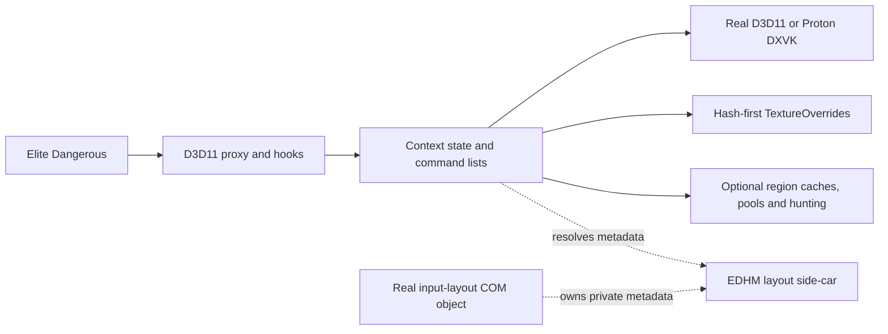

# EDHM_2DMigoto optimization, architecture and performance audit

**Snapshot:** `34d92f27f588bbc3f72320c0fa17b674638698c6`  
**Audit date:** 2026-11-12  
**Target workload:** Elite Dangerous Odyssey + EDHM, including the user's Linux/Proton installation.

**Performance comparison baseline:** XXMI **v0.9.8**, the milestone selectively
ported into this project, as confirmed by the user. Newer XXMI releases are
reference material for proposed ports. The vendor-cache DLL is used only for
installed-binary provenance, not as the performance baseline.

## Executive summary

The current code combines the original 3Dmigoto engine, XXMI's 2D modding and
resource/command-language changes through a selective v0.9.8 port, and EDHM's
compatibility, ownership, Wine, diagnostic and hunting changes. Many large diffs
are formatting or correctness work. They must not be counted as performance
optimizations simply because code changed.

The most relevant existing reductions for ordinary EDHM use are quieter logging,
bounded Present log flushing, hash-first TextureOverride matching, and avoiding
inactive hunting binding queries. Region caching, staging-buffer reuse and custom
pools have different activation requirements; they cannot explain a speedup in a
workload that never uses them. Several safety changes intentionally add checks,
copies, locks or references.

One component improvement was measured separately: folding region offsets into
the L2 hash dramatically reduces collisions in the extracted region-cache map.
For **1,024 equal-sized regions at 64-byte-spaced offsets**, the hash change alone
reduced median hit lookup from **216.26 ns to 8.15 ns** and miss lookup from
**420.63 ns to 15.51 ns** in this benchmark. The current map-template variant measured
**8.82 ns / 16.50 ns**, retaining the safety bounds. These are synthetic CPU map
lookups, **not Elite frame-time or FPS gains**. The source template disables region
tracking by default. [Raw measurements](audit-data/region-cache-raw.csv),
[environment](audit-data/region-cache-environment.json).

The latest XXMI release is v1.2.3, substantially beyond the local milestone.
Newer candidates include parser compaction and lookup reuse, TextureOverride
candidate caching, adjacent resource-slot batching, cache-first `store`, and
compatible view reuse. Source and upstream PRs establish mechanisms, but do not
provide controlled individual game-performance results. The proposed adoption
order below is therefore based on relevance, work removed, dependencies and
risk; it is **not a measured FPS ranking**. [Upstream audit](audit-upstream-baselines.md).

The Linux installation contains a roughly 9.4 MB diagnostic log and 13 dated
frame-analysis captures, plus a deduplicated resource directory. No paired
frame-time captures were found in the searched locations. `dump_usage=1` is
enabled, and the installed DLL is not the vendor-cache DLL by hash. This makes
baseline preparation the first practical step. No game configuration or runtime
binary was changed during this audit. [Installation evidence](audit-data/linux-install-evidence.json).

**Status:** source/history audit, component measurements, brief and adoption
proposal are delivered. **Individual in-game performance attribution remains
unmeasured.** The isolated CPU component result is reported separately. Completing that
part requires matched Release variants and fresh, repeatable scene captures;
existing resource dumps cannot supply those missing timings.

## Reading guide and coverage

| Artifact | Contents |
|---|---|
| [Brief](performance-audit-brief.md) | Short decision brief and proposed sequence |
| [Inherited optimization audit](audit-inherited-xxmi.md) | I01–I20: original-to-XXMI mechanisms, retained/absent status, eight architecture areas and focused findings |
| [Local change audit](audit-local-changes.md) | L01–L10: EDHM reductions, eleven architecture groups, correctness costs and individual experiments |
| [Upstream release audit](audit-upstream-baselines.md) | Verified baselines, H01–H14 historical cross-check, U01–U17 newer candidates, architecture changes and all 183 non-merge commits in the newer XXMI range |
| [Changed-file manifest](audit-data/changed-files.csv) | Every changed path in the six comparison ranges, including removals, binary markers and broad file categories |
| [Benchmark harness](../scripts/benchmark-region-cache.py) | Reproducible extraction, isolated variants, raw observations, summary and metadata |
| [Installation evidence](audit-data/linux-install-evidence.json) | Sanitized local findings, binary hashes, configuration observations and profiling limitations |

I/H entries overlap intentionally: H is an upstream-history cross-check, not
another set of gains to add to I. Likewise L06 is the measured hash change;
it must not be counted again as a separate improvement under inherited region
caching. The appendices contain the detailed function/commit citations and
activation conditions for each mechanism.

The inventory covers runtime and linked shader/decompiler source, public proxy
contracts, command/configuration processing, cache/pool state, optional analysis,
build/dependency structure and quality/release automation. The changed-file
manifest includes vendor and removed components so repository slimming is visible.
It is a mechanical coverage index, not a claim that every removed vendor line
was a runtime optimization or that an exhaustive security review was performed.
User-owned untracked `addons/` content is outside the tracked snapshot.

## Release baselines and comparison direction

| Baseline | Pinned commit | How it is used |
|---|---|---|
| Original latest stable **1.3.16** | `cbc4993ca67b6d639e06c578d4e3dc8b3780243f` | Historical stable-to-current comparison |
| Original newest published build **1.4.9 beta** | `4ce5f2f72b2777223d2e809dcdafec514ac98295` | Latest-published-original-to-current comparison; distinguishes changes already in the beta |
| XXMI selectively ported milestone **v0.9.8** | `f8e7118a1220e43546e546efa31892b8304358df` | Separates inherited XXMI mechanisms from local EDHM adaptations |
| XXMI latest published release **v1.2.3** | `065dc746c21c71ef48bbc93cb6b90b3dcdf766e6` | Newer upstream candidates, compared semantically with current local code |
| Local stable **v0.1.3** | `8d4272e5beb0203470afd5bdc3644e1fda4c510e` | Determines whether anything changed after the local release |
| Audited local HEAD | `34d92f27f588bbc3f72320c0fa17b674638698c6` | Fixed current code, not a moving branch name |

Original 1.4.9 is explicitly a prerelease; 1.3.16 remains the stable baseline.
Both are covered to avoid ambiguity in “latest release.” XXMI v1.2.3 and its
branch tip were identical at retrieval, so there was **no post-latest-release
XXMI branch delta**. The newer candidate range is v0.9.8→v1.2.3. Original branch
code after 1.4.9 adds decompiler functionality, not an established optimization.
[Original beta](https://github.com/bo3b/3Dmigoto/releases/tag/1.4.9),
[XXMI release](https://github.com/SpectrumQT/XXMI-Libs-Package/releases/tag/v1.2.3),
[full baseline metadata and date caveat](audit-upstream-baselines.md#1-exact-baselines-and-what-latest-means).

The newer XXMI range contains 241 commits, including 183 non-merge commits,
and 68 changed files. This is not the number of optimizations. The local tree
uses cherry-picks/manual ports and a reduced solution, so ancestry ahead/behind
counts cannot determine which behaviors are missing.

Local v0.1.3→HEAD changes **only one release-workflow line**, adding the strict
C++17 build property to Zip Release. There is no new runtime algorithm in that
narrow range. Comparing DLLs built by different pipelines could still differ in
code generation; that is a separate compiler/build comparison.
[Local release diff](https://github.com/Fenris159/EDHM_2DMigoto/compare/8d4272e5beb0203470afd5bdc3644e1fda4c510e...34d92f27f588bbc3f72320c0fa17b674638698c6).

## Architecture changes that matter to performance



| Area | Original/inherited change and current EDHM contract | Performance consequence |
|---|---|---|
| Scope and deployment | Stereo machinery removed in XXMI; local solution retains the DirectX11 DLL, BinaryDecompiler and DirectXTK graph. Compiler redistributable is packaged separately. | Less supported functionality and a smaller build graph; neither proves an equivalent-workload frame gain. |
| Input layouts | EDHM returns real runtime pointers and attaches private owned metadata; override commands bind the original layout. Upstream device-level deduplication is **not retained** in current EDHM. | Compatibility is mandatory. Side-car metadata reuse is not device-level `CreateInputLayout` deduplication. |
| Initialization/platform | One-time initialization, TLS redirect suppression, public-export forwarding and standard Wine/DXVK chaining. | Correctness and thread/platform behavior; additional serialization/checks can cost time. |
| Logging and lifecycle | Separate enabled/calls/debug controls, open-time rotation, bounded scheduled flushing and safe termination handling. | Cost depends on emitted bytes, buffering and path activation. Rotation is not a continuous session-size cap. |
| Matching and configuration | Early includes available for first frame, classic hash-first precedence, theme signal polling. | Some extra startup parsing; less fuzzy work on successful hash matches; polling trades detection latency for fewer metadata calls. |
| Resource identity/cache | CPU snapshots, per-resource `(offset,size)` L2 and per-frame global L3, correct range versions, bounded probes and owned snapshots. | Reuse avoids CRC/readback on hits. Invalidations, memory copies, allocation and locks remain costs. |
| Transfers | Shared size-bucket staging buffers and mirrored eligible CPU updates. | Fewer buffer creations; a cold GPU readback still synchronizes. Local fallback currently performs two CPU copies for safe ownership. |
| Command language/pools | Argument reader, richer expressions, locked declarations, indexed/expiring/spatial/proxy pools and layout commands. | More expressiveness and optional reuse; spatial fallback/expiry can scan linearly. Original already had internal copy-resource reuse and literal constant folding. |
| Shader processing | Bytecode model caching and no-pattern ShaderRegex shortcut; later upstream adds separate reflection/parser state. | Startup/first-use work can be avoided or added. Current patterned cache-miss path disassembles twice. |
| Hunting/analysis | Optional Level 2 immediate-context identities, bounded registry, effective-binding snapshots, conservative reports; deferred draws excluded. | Diagnostic cost, not a normal-play optimization. Disabled-state helpers still take locks. |
| Native quality/build | C++17 strict gates, ownership/const/bounds repairs, stack protection, clang tools, shader validation and Sonar capture. | Reliability and repeatability. Formatting and analyzer closure have no established runtime gain; `/GS` can add work, `/MP` affects builds. |
| Newer upstream | Syntax targets, bytecode reader, metadata getters, cache policy, batch operations, timing/persistence/logging changes. | Significant dependency and behavioral surface. Import small measured mechanisms while preserving local contracts. |

Detailed before/after contracts and source anchors are in the three appendices.
In particular, do not reintroduce wrapped layout pointers, change hash/fuzzy
precedence, remove snapshot ownership, or weaken invalidation/probe safety while
chasing a benchmark result.

## Measurements executed

### Region L2 hash and map safety, isolated

The harness extracts the actual map/key/hasher definitions from pinned upstream
v0.9.8 and local HEAD. All variants use the extracted **current**
`RegionCacheEntry` payload (`uint32_t hash`, `uint64_t version`) and call
`find_ptr`, matching the current L2 map lookup method. The historical 32-bit
version payload is deliberately held out of this comparison to isolate hashing
and probe behavior at the same entry footprint. It constructs three variants:

1. Upstream map + upstream hash.
2. Upstream map + current hash: **isolates the hash change**.
3. Current map + current hash: compares the remaining map changes, chiefly bounded
   probes, against variant 2 without changing hash distribution.

Each table has preallocated capacity twice the entry count (0.5 load). Identical
fixed-seed shuffled hit and absent-key streams run for 200,000 lookups/sample,
15 samples/variant/case, with warmup and alternating forward/reverse variant
order. Variant output checksums agree. Construction, allocation and insertion
are outside timing. The run produced **450 observations / 30 groups / 90 million
timed lookups**. It uses wall-clock batch timing, not hardware performance events.

Host: AMD Ryzen AI MAX+ 395, Linux x86-64, GCC 15.2, `-std=c++17 -O2 -DNDEBUG`,
logical CPU 2 affinity. Compiler, extraction and harness hashes are recorded in
the [environment artifact](audit-data/region-cache-environment.json).

| Synthetic keys / operation | Upstream map+hash median ns | Hash only median ns | Current map median ns | Isolated hash speed ratio |
|---|---:|---:|---:|---:|
| 256 dense offsets, hit | 60.86 | 1.50 | 1.51 | 40.5× |
| 256 dense offsets, miss | 113.11 | 1.51 | 1.56 | 74.9× |
| 1,024 dense offsets, hit | 216.24 | 1.52 | 1.54 | 142.1× |
| 1,024 dense offsets, miss | 421.78 | 1.44 | 1.60 | 293.3× |
| 1,024 offsets at 64 bytes, hit | 216.26 | 8.15 | 8.82 | 26.5× |
| 1,024 offsets at 64 bytes, miss | 420.63 | 15.51 | 16.50 | 27.1× |
| 4,096 offsets at 64 bytes, hit | 843.57 | 10.26 | 10.79 | 82.2× |
| 4,096 offsets at 64 bytes, miss | 1,678.50 | 17.04 | 18.28 | 98.5× |
| 1,024 offsets, 17 sizes, hit | 211.80 | 1.77 | 1.79 | 119.7× |
| 1,024 offsets, 17 sizes, miss | 429.67 | 2.45 | 2.57 | 175.1× |

The upstream hasher packs offset in the high 32 bits and size in the low 32
bits. The map masks low bits for ordinary small capacities, so equal sizes all
start at the same bucket. The local XOR fold brings offset entropy into the
masked bits. At capacity 2,048 the aligned 1,024-entry workload starts in **one
bucket upstream versus 32 locally**; dense offsets use 1,024 local start buckets.
Aligned inputs therefore still collide after the fix.
[Source and introducing commit](audit-local-changes.md#optimization-ledger),
[bucket counts and all samples](audit-data/region-cache-raw.csv).

The current map adds approximately **0.67 ns/hit and 0.99 ns/miss** versus
hash-only for the 1,024-entry aligned case in this run. Across all cases the
median difference ranges from approximately **0.00 to +1.24 ns**. Keep the
safety checks. Code layout, scheduling and measurement noise affect small
differences; this comparison also contains minor source/type-declaration
changes, so the sub-nanosecond portion cannot be uniquely attributed to one
branch instruction.

These workloads deliberately expose the known collision mechanism. They are
**not a sampled distribution from Elite**, not a complete cache profile, and
not a benchmark of original 3Dmigoto, which has no equivalent region map.
The numbers exclude CRC, global locks, page validation, invalidation, GPU stalls,
insertion/erase/clear, allocator work, concurrent contexts and frame scheduling.
The payload version check and `GetRegionVersion` are also excluded; returned
hash values are consumed to keep successful lookups observable. Only one
process/session was measured; raw min/max describe within-session
variation, not confidence across machines or days. No FPS conversion is valid
without measuring path frequency and the frame's critical path.

Reproduce on Linux, keeping output from different sessions in separate folders:

```bash
python3 scripts/benchmark-region-cache.py --cpu 2 --output .quality/audit-repeat
```

The script creates compiler intermediates under `.quality/audit-region-cache`.
It does not build, deploy or edit the game DLL. Its default references are fixed
to this audit; alternate `--base` and `--current` revisions must retain compatible
template definitions.

### Existing behavior checks

The existing `AdvancedHuntingTests` executable was compiled with MinGW-w64 GCC
13 using C++17, `-O2 -Wall -Wextra -Werror -static`, then run under Wine 10.
It printed **“Advanced hunting tests passed”** and returned zero. This checks
existing identity/report/lifecycle behavior in that toolchain. It does not
validate COM hooks, live Elite compatibility, MSVC warning/analysis gates or
performance. Production C++ was not modified, and no new behavior tests were added.

Linux `perf stat` for task-clock/cycles/instructions was attempted and rejected
under `perf_event_paranoid=4`. Hardware counters/CPU sampling were therefore
unavailable. No system security setting was changed to bypass that limitation.

## Findings in the user's Linux installation

Inspected product directory:

```text
/home/drew/.local/share/Steam/steamapps/common/Elite Dangerous/Products/elite-dangerous-odyssey-64
```

| Observation | Implication |
|---|---|
| Game version `2026.10.23.334925`, Steam build `26155938` | Pin both for subsequent captures. |
| `EDHM-ini` resolves to `/home/drew/EDHM_UI/ODYSS/EDHM/EDHM-Ini`; ShaderFixes is also linked | A theme/UI change can alter the workload between runs; capture the resolved files, not only top-level INI. |
| Log reports Proton/Wine 11.0 and Linux-safe profile | Use this renderer/platform as the primary game benchmark; Windows comparisons are separate. |
| First and last logged effective settings show `enabled=1`, `calls=0`, `debug=0`, `unbuffered=0`, `export_hlsl=0`, **`dump_usage=1`**, `hunting=0` | Measure the current diagnostic configuration, then separately measure a normal-play variant with usage dumping disabled. Hunting was toggled during some intervening log intervals. |
| Installed DLL SHA-256 `d1fca1312e4435634148c0e46341ac7306ac0f4e2c421d4788262631cbf214c2`, size 3,198,464 | This is not a proven build of the audited source merely because its version says 0.1.3. |
| Vendor LFS object SHA-256 `8f8dc2c40b8cfe16d4eb7aa80f5fba4b245d57847bda2004ba1667a9cd7a2a34`, size 3,156,480 | The working-tree vendor file is an LFS pointer; compare its expected object hash, not the pointer-text hash. |
| Launcher source requests Gamescope Wayland at 3840×2160, refresh argument 120, `RADV_DEBUG=nodcc` | These are configuration observations, not measured FPS. Preserve them for matched comparisons; a cap can hide throughput changes. |
| 13 dated frame-analysis directories plus `FrameAnalysisDeduped` | Useful shader/resource fixtures. They have no paired variant frame-time observations and are not a deterministic rendering replay. |
| No performance summary/frame-time lines in the wrapper log, no matching timing captures found in the searched install/user locations; game not running | Historical per-change frame gains cannot be recovered from these artifacts. |
| MangoHud command absent; `perf` events blocked; Windows C/G mounts unavailable | Fresh game captures need a configured recorder and scene. Windows access can be restored separately with `~/bin/mount-lr-gamingpc.sh`. |

The launcher state logs were also checked; no FPS/frame-time series was found.
Searches were scoped to the installation, relevant launcher state, MangoHud
configuration and likely user export locations; this does not assert no timing
file exists anywhere on the host. Source defaults such as `track_region_hashes=0`
are not proof of the effective setting in an unverified installed DLL.
[Recorded evidence](audit-data/linux-install-evidence.json).

## Separate performance results by change family

| Change family | Individual result established in this audit | What remains to measure |
|---|---|---|
| L06 region L2 hash | **Measured**, table above; single-hash isolation | Real query distribution, calls/frame and total critical-path cost |
| Bounded map probes | **Component comparison measured**, retaining same folded hash | Full cache behavior/concurrency; never accept nontermination for speed |
| L01 log flush | Source schedule: about 60→1 scheduled calls/s at 60 Present/s with debug off; **time unmeasured** | Equal emitted bytes and buffering, flush CPU/wall time, syscall and disk activity |
| L02 quiet messages | Fewer enabled formatting/output paths; **time unmeasured** | Bytes/calls, creation/matching CPU and frame hitches, independently of flushing |
| L03 Present1 debug fix | Stops forced debug toggling; **time unmeasured** | Confirm Present1 is used; compare otherwise-identical variants |
| L04 theme polling | 4→0.5 maximum steady polls/s, **87.5% fewer calls**, not a timing result | Metadata-call cost and theme-apply latency; no watcher exists in stock baseline |
| L05 hash-first matching | Fuzzy work skipped on hash hits; **time unmeasured** | Match counts, ordered results/filter indices, CPU on actual EDHM rules |
| L07 range summaries | Fewer checks than a correct full-page scan; **time unmeasured** | Compare two correct algorithms across page/block boundaries |
| L08–L09 hunting | Inactive binding queries avoided; locks remain; **time unmeasured** | Disabled/configured/active/locked/verbose costs and lock waits |
| L10 process exit | Cleanup skipped on process termination; **time unmeasured** | Shutdown behavior/duration, separately from gameplay |
| I01–I04, I06, I17–I20 | Mechanisms and baseline attribution established; **time unmeasured** | The per-ID startup/expression/stereo/build/loader experiments in the inherited appendix |
| I05, I07–I16 | Cache/prefilter/pool/readback mechanisms established; **time unmeasured outside map test** | Hit/miss, upload/invalidation/readback overhead, memory and optional-feature activation |
| U01–U17 newer XXMI candidates | Source mechanisms/dependencies verified; **no individual game timing established** | One candidate/variant pair at a time, using each appendix row's metric |
| Ownership, Wine, API, parsing and quality repairs | Correctness/architecture changes; **no speed claim** | Compatibility, memory/lifetime behavior and cold-load costs where applicable |

“Unmeasured” is not zero improvement. “Inactive in the test” is not zero global
overhead. No sums of these percentages or extrapolated aggregate FPS are reported.

## Proposed changes and order for Elite + EDHM

This is a proposal; runtime fixes, upstream ports and installed configuration
changes have not been applied. Existing compatibility/safety work should be
retained even where it adds instructions.

| Order | Change or decision | Basis and prerequisites | Evidence needed before promotion |
|---|---|---|---|
| 0 | Establish a known current Release build and repeatable Linux scenes; compare current `dump_usage=1` against normal-play `dump_usage=0` | Installed binary provenance differs; diagnostic work is active now. Preserve resolved INI/shaders and launcher. | DLL/patch/config hashes, identical scene and fresh paired frame captures |
| 1 | Remove duplicate `BinaryToAsmText` on successful patterned ShaderRegex cache misses; separately evaluate a safe disabled-hunting fast gate | Small source-visible redundant operation and unnecessary lock-path candidate. Shader fix has value only when applicable pattern misses occur; hunting gate must be synchronized across reload. | Identical generated replacements, cold/warm first-use timing; hunting-disabled/active checks and lock counters |
| 2 | Apply relevant correctness prerequisites from newer upstream, including pool bind-flag metadata without lazy allocation (U17), region/SO boundary fixes and shader error-blob ownership | Port fixes only where the affected local path exists. They do not need an FPS justification. | Boundary/lifetime/output checks; preserve existing local fixes |
| 3 | Port constants compaction (U01), current-section reuse (U08), then static-condition memoization (U02), operator-category/direct-tree parsing (U03/U04), normalization (U05) | Narrow load/reload changes are easier to isolate; do not equate startup gains with steady FPS. U05 needs the final Unicode/namespace contract. | Actual EDHM cold/warm reload ms and parse CPU, with unchanged values/order/errors |
| 4 | Consider contamination buffer early exit (U10) and source-view reuse (U16) independently | Small hot-path candidates, but only useful when tracking/copy paths execute. `GetType`/QueryInterface add work. | Per-resource-type/copy counts, tracking/copy CPU and COM behavior |
| 5 | Implement an **EDHM-adapted** TextureOverride candidate cache (U12) | Strong candidate if repeated matching dominates; preserve hash-first option, untracked-resource fallback, draw-dependent filtering, invalidation and locking. | Exact ordered match equivalence across resource churn/reload; hit/rebuild cost and memory; frame captures |
| 6 | Port fixed adjacent SRV bind/fetch batching (U13) | Needs qualifying adjacent commands. Preserve order, null/gap/dynamic-slot exclusions, hazard behavior and references. | API call reduction plus CPU/frame-time result and identical output |
| 7 | Consider configurable CPU cache/cache-first `store` (U15) only if readback stalls are material | Can shift cost into writes and memory. Keep region tracking off when unused. | Cache hit/miss and Map stalls together with write-copy cost and RAM, not read-only hit timing |
| 8 | Port conditional batching (U14) only after U13, using corrected PR68 series | Earlier PR66 was reverted after an unsigned slot-index failure. | Slots above zero, missing else, nested/pre/post and pipeline-reading conditions; cumulative scene validation |
| 9 | Defer broader reflection/member/range language, timing/logging replacement, spatial-pool changes and layout dedup redesign until needed | Larger behavioral/dependency surface, no established ordinary-EDHM gain. | A real mod/support requirement and separate architecture/compatibility review |

The strongest **measured** retention decision is keeping the folded L2 hasher
with bounded probes. That does not move region hashing ahead of active ordinary
EDHM costs: its benefit is conditional on use. The order of U10/U16 versus parser
work can move earlier if a real profile shows those paths dominate. U12 may also
move earlier after instrumentation establishes matching as the main cost.
[Candidate sources/risks](audit-upstream-baselines.md#3-newer-xxmi-performance-candidates-missing-from-the-local-milestone),
[local redundant-call evidence](audit-inherited-xxmi.md#f01-duplicate-disassembly-on-the-pattern-path).

## Protocol for finishing per-change in-game attribution

1. **Pin inputs.** Record source/patch SHA, DLL SHA-256, exact build toolchain and
   Release flags, game build, Proton/DXVK/Mesa versions, resolved INI/ShaderFixes,
   renderer/launcher settings, frame cap, display mode and thermal conditions.
   Version strings and release names alone are insufficient.
2. **Use a repeatable workload.** Capture a stationary cockpit and a fixed station
   or training scene, plus cold shader-use/reload scenarios separately. Do not
   substitute unrelated online locations or another machine as the control.
   The existing frame-analysis snapshots are fixtures, not timing replays.
3. **Separate single-change pairs and cumulative order.** Build A and B from the
   same base, differing only in the named optimization and its correctness
   prerequisites. Separately compare each cumulative adoption step. Preserve
   safe ownership/invalidation in both variants; unsafe/crashing outputs fail.
4. **Warm and interleave.** Warm steady tests for at least 30 seconds, then take
   five or more A/B pairs of equal-length 60–120 second intervals. Alternate order
   and extend if run-to-run variance is large. Keep cold shader/DXVK cache tests
   in a separate series; do not reset or mix caches for steady-state runs.
5. **Measure the right layer.** Collect per-frame durations and CPU/GPU load;
   report median, p95, p99 and hitch counts under a predeclared threshold. Use
   the existing wrapper CPU profiler/counters in separate diagnostic passes to
   identify matching, command, Present, Map and region work. Its overlay and
   QueryPerformanceCounter calls add overhead; nested times cannot all be added.
6. **Report uncertainty and correctness.** Use paired run-level deltas with
   intervals; frames within one run are correlated and are not independent trial
   replicates. Compare output/match behavior and memory before ranking speed.
   If the change is below the observed detection limit, say so. Keep raw data and
   negative/regression results.

For Linux/Proton, a configured Vulkan frame recorder such as MangoHud can log
to a local `output_folder`, with `log_interval=0` and explicit duration. Its
documented default logging toggle is Shift+F2. Integrate it at the game process,
preserving the existing split Gamescope launcher, and confirm which process is
being recorded; compositor timing is not automatically game timing. This audit
did not install/inject it or change Steam launch settings.
[MangoHud logging documentation](https://github.com/flightlessmango/MangoHud#fps-logging),
[configuration options](https://github.com/flightlessmango/MangoHud#hud-configuration).

Each result should retain: change ID, old/new patch and binary hashes, scene ID,
run order, cold/warm status, effective optional flags, recorder version/settings,
duration/frame count, frame-time distribution, operation counts, CPU/GPU/memory
metrics, paired deltas/uncertainty, correctness verdict and keep/reject decision.
Startup/reload, build throughput, shutdown, memory savings and steady frame cost
must be reported in their own units.

## Verification and limitations

Release evidence was checked against first-party pages/APIs and immutable Git
objects. Runtime claims were traced to functions, not inferred from commit
subjects. New upstream source was inspected in an isolated temporary clone;
working-repository mirror refs were not advanced. Whitespace-insensitive diffs,
historical baselines and current-source checks were used to avoid counting
modernization or original functionality twice.

The deliverables include the source-based inventories, architecture changes,
individual measurement requirements, actual map benchmark data, installation
evidence, summary and proposal. They **do not establish performance improvement
for every change in live Elite**. No matched game DLL variants/scene recordings
were available, the game was stopped, native MSVC builds were unavailable here,
and hardware profiling was blocked. The audit's ranking remains provisional
until those experiments are run. No production source, installed game files,
user addons or active configuration was edited.
